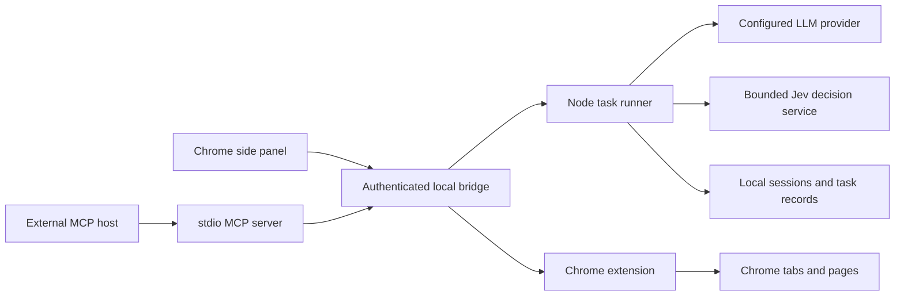

# Agentic Browser Assistant

**A local Chrome browser agent with an MCP server, configurable LLM planning, and bounded Jev execution.** It works with a user's existing Chrome profile and sessions through a visible Manifest V3 extension.

> **Project status:** Experimental, personal-use software. Browser controls and several task paths have automated test coverage, but general task reliability, long unattended runs, and semantic completion verification are still being developed. Review [known limitations](#current-limitations) before relying on it for important work.

## What it does

- Controls Chrome through the extension using native browser input and Chrome DevTools Protocol (CDP).
- Exposes browser operations through a local bridge and a stdio [Model Context Protocol (MCP)](https://modelcontextprotocol.io/) server.
- Offers three ways to run browser work: an external MCP host, bounded Jev tasks with caller-supplied values, and a configurable LLM planner in the extension's side panel.
- Groups newly opened task tabs in a visible **JEV Browser** tab group.
- Observes pages using scoped DOM snapshots, screenshots, accessibility data, and selected browser diagnostics.
- Keeps conversation history and explicitly saved facts on the local computer.

The browser executor is JavaScript. The current chat planner and MCP service run on Node.js. The Python orchestration design described in the [development plan](docs/AGENT-DEVELOPMENT-PLAN.md) is **proposed work**, not part of the current release.

## Architecture



The MCP host can use the browser tools directly with its own model. The built-in `browser_run` planner uses the configured LLM provider. `browser_fast_run` is a separate bounded Jev task entry point; automatic delegation from ordinary chat is a planned improvement. See [architecture](docs/ARCHITECTURE.md) for more detail.

## Requirements

- Chrome or Chromium 125 or newer
- Node.js 22 or newer
- An LLM provider API key only when using the built-in general planner
- A TypeSafe Jev API key only when using Jev features that require it

Direct MCP browser operations do not require an extension-side LLM key. Provider and Jev keys are stored in the local configuration and are not needed to build the extension.

## Install from source

```bash
git clone <repository-url>
cd agentic-browser-assistant-mcp
npm ci
npm run setup
npm run build
npm run bridge
```

`npm run setup` creates local pairing and MCP configuration under `.local/`. Keep this directory private; it is excluded from version control. Leave the bridge running while you use the extension.

In Chrome:

1. Open `chrome://extensions` and enable **Developer mode**.
2. Select **Load unpacked** and choose `dist/extension`.
3. Open the JEV Browser side panel, choose **Settings**, then expand **Connection & models**. Leave the Bridge URL as `http://127.0.0.1:19847` unless you changed the local port. Copy the pairing token from `.local/config.json` into **Pairing token**, then select **Connect extension**. Keep the token private.
4. To use the built-in chat planner, choose a provider protocol, enter its base URL and exact model ID, add the provider API key, and save. To use Jev tools, enable Jev, enter the Jev API key, and save. Direct MCP browser controls can be used without configuring either key in the extension.
5. Return to **Chat**, select a tab, enter a task, and choose **Run task**. The general planner starts the task. Bounded `browser_fast_run` is started through MCP.

The unpacked extension uses Chrome's debugger permission for native input and screenshots. Chrome displays its debugger notice while the extension is attached. Enterprise policies may restrict this capability.

## Connect an MCP client

The stdio server starts with:

```bash
npm run mcp
```

For clients that accept an MCP JSON configuration, add an entry with the absolute path to `server/mcp.mjs`:

```json
{
  "mcpServers": {
    "jev-browser": {
      "command": "node",
      "args": ["/absolute/path/to/jev-browser/server/mcp.mjs"]
    }
  }
}
```

The MCP process connects to the authenticated local bridge. The bridge and paired extension must run on the same computer. Do not expose the loopback bridge to the public internet. MCP client setup varies; consult the documentation for your client.

For manual diagnostics, the included client can make calls over the real stdio MCP connection:

```bash
npm run call -- browser_status '{}'
npm run call -- browser_tabs '{}'
npm run call -- browser_snapshot '{"tabId":123}'
```

Use `npm run session` for multiple calls over one persistent MCP connection.

## Execution modes

### Direct browser tools through MCP

An external MCP host decides which tool to call and supplies its own model. The browser extension performs the operation and returns observations, screenshots, or action results.

### Bounded Jev tasks

`browser_fast_run` accepts supplied form values, permitted button labels, and explicit success predicates. The local executor binds values and Jev selects among eligible page actions. The task has limits on steps, requests, and duration. Unsupported or ambiguous situations return a typed outcome for further planning.

Jev is a constrained decision component. It does not replace the general planner for open-ended research or generate missing credentials, arbitrary text, or an unrestricted action plan.

### General chat planner

The side-panel task runner uses the configured LLM provider to inspect a task, call browser tools, and report progress. Chat-to-Jev delegation, structured long-task plans, and durable restart recovery are not yet implemented. Track these in the [development plan](docs/AGENT-DEVELOPMENT-PLAN.md).

## Browser capabilities

The MCP toolset includes navigation, tabs and tab groups, DOM snapshots and extraction, screenshots, accessibility observations, native mouse and keyboard input, form filling, waits, downloads, dialogs, and multi-tab batches. Additional tools cover diagnostics, viewport metrics, local uploads, and page JavaScript behind the advanced-access setting. The exact tool inventory is available from the MCP server.

Site content is untrusted input to the agent. Broad HTTP(S) access is enabled by default after Chrome grants the extension's host permission; the user can pause access, block sites, or apply read-only overrides. Advanced JavaScript and uploads are separately controlled. Chrome's own protected pages, operating-system dialogs, and some browser security prompts are outside the webpage-control surface.

## Current limitations

- **Goal verification needs improvement.** A fresh text excerpt can show that words appeared on a page; by itself, it does not prove that a requested record, key, or file was actually created. The [agent audit](docs/AGENT-AUDIT-2026-10-06.md) documents a false-success regression. Do not treat final prose as independent proof.
- **General chat does not yet automatically delegate bounded tasks to Jev.** Bounded Jev execution is available through its own tool entry point.
- **Restart recovery is incomplete.** Running work is marked interrupted after a bridge restart. Unknown browser actions require inspection; the agent does not automatically resume an entire long task.
- **Provider output is not streamed token by token.** The side panel reports task stages, while provider latency can still dominate response time.
- **Visual reasoning and complex app workflows need more evaluation.** Screenshots and coordinate input are supported, but complex spreadsheets, documents, canvas editors, and custom widgets are not established as reliable workflows.
- **Automation does not bypass authentication challenges.** When an unavailable factor or security check is required, the task needs an appropriate user handoff.
- **A local bridge still sends selected page observations to the configured model services.** Local storage does not mean all processing stays on the computer.

See the [evaluation program](docs/AUTONOMOUS-BROWSER-EVALUATION.md), [validation notes](docs/VALIDATION.md), and [capability gaps](docs/CAPABILITY-GAPS.md) for evidence and the planned measurement approach.

## Development and evaluation

```bash
npm run check
npm test
npm run build
```

`npm run test:e2e` runs the browser integration suite when the local environment supports its Chromium setup. `npm run evaluate` and `npm run benchmark` run fixture-based evaluations. Read [validation](docs/VALIDATION.md) before interpreting their results: deterministic browser fixtures test mechanics and contracts, not general model intelligence or success on arbitrary live websites.

The project has a custom Node.js agent runtime and does not currently use LangGraph, CrewAI, or AutoGen. A Python LangGraph backend is a proposed architecture direction; framework research and decision gates are in [the comparison](docs/FRAMEWORK-COMPARISON-2026-10-06.md). No framework migration should be inferred from this README.

## Repository layout

| Path                             | Purpose                                                                          |
| -------------------------------- | -------------------------------------------------------------------------------- |
| `extension/`                     | Chrome Manifest V3 background worker, side panel, and browser operations         |
| `server/`                        | Local bridge, task runner, provider adapters, bounded Jev engine, and MCP server |
| `shared/`                        | Browser tool schemas, protocol, and tool groups                                  |
| `skills/`                        | Local Markdown workflow instructions                                             |
| `tests/`                         | Unit, fixture, and Chromium integration tests                                    |
| `scripts/`                       | Build, setup, evaluation, benchmark, and MCP client utilities                    |
| `docs/`                          | Architecture, validation, audits, research, and development plans                |
| `artifacts/research-2026-10-06/` | Curated Jev architecture and evaluation research notes                           |

## Security and privacy

Keep `.local/`, `.env` files, API keys, pairing tokens, browser exports, and personal traces private. Never commit live credentials or real account data. Rotate any credential that was accidentally published. Before running a public build, review the exact staged file list and scan it for secrets and private data.

The bridge is intended for local use. Website content can contain malicious instructions; prompts and scoped permissions reduce risk but cannot guarantee protection from prompt injection. Sensitive tasks should be monitored and independently verified.

## Project status and roadmap

This is an experimental personal-use project. The current priority is a trustworthy evaluation harness and stronger task-specific verification, followed by chat-to-Jev delegation, cross-site authentication workflows, and restartable long tasks. Broader skills, semantic memory, application-specific workflows, and visual reasoning remain future work.

- [Agent development plan](docs/AGENT-DEVELOPMENT-PLAN.md)
- [Framework comparison](docs/FRAMEWORK-COMPARISON-2026-10-06.md)
- [Autonomous browser evaluation](docs/AUTONOMOUS-BROWSER-EVALUATION.md)
- [Architecture](docs/ARCHITECTURE.md)
- [Validation](docs/VALIDATION.md)

## License

No license file is currently included. Unless a license is added, this repository does not grant standard open-source rights to reuse, modify, or redistribute its code.
