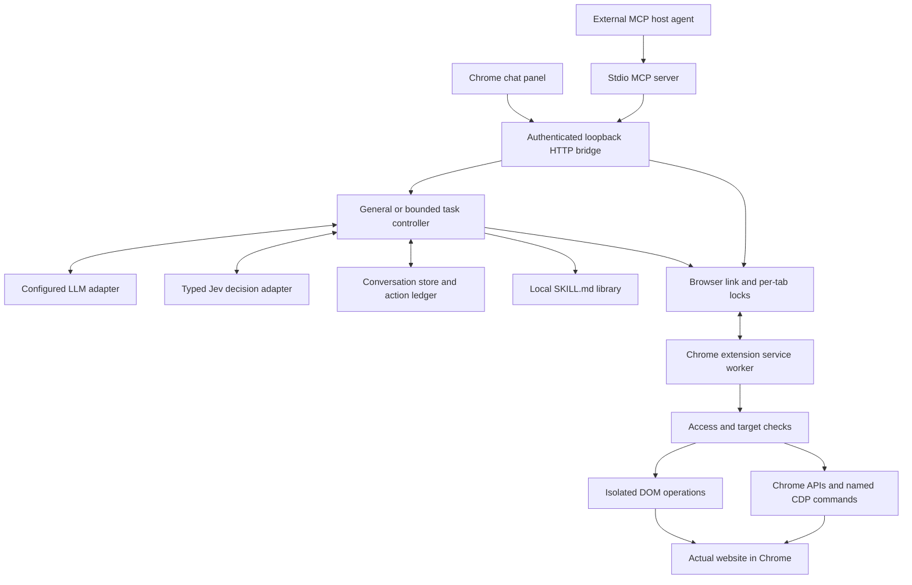

# JEV Browser agent audit — 6 October 2026

Audited source: **0.4.1**. This is a code and evidence audit, not a new autonomous live-site benchmark. Existing unit/integration tests were rerun: **82 passed**, zero failures, approximately 1.96 seconds. An additional in-memory adversarial verification probe exposed a goal-verification weakness. No personal browser records, provider settings, keys, or production behavior were changed by this audit.

## Assessment

The application has a custom browser-agent runtime, a capable extension executor, and a bounded Jev controller. Browser mechanics have significantly broader evidence than autonomous decision quality. The source does not support a claim of general Claude-level reliability, arbitrary website completion, or unattended overnight task reliability.

The most consequential gaps are independent goal verification, planner-to-Jev delegation, realistic end-to-end evaluation, durable recovery for long tasks, and validation of visual reasoning with the configured provider.

## 1. Framework and implementation stack

There is no general-purpose orchestration framework such as LangGraph, CrewAI or AutoGen in package.json or the task-runner implementation. The agent runtime is custom JavaScript ESM running on Node.js 22+; the current development environment uses Node 24.

- The Chrome Manifest V3 extension has a service worker and a side panel implemented with ordinary HTML, CSS and JavaScript.
- Node's HTTP server and the ws package implement the authenticated loopback bridge and extension WebSocket.
- The official MCP JavaScript SDK implements the stdio MCP interface.
- Zod validates tools, goals, configuration and bounded subtask specifications. JSON schemas are generated from the same definitions for model tool calling.
- esbuild bundles the extension background worker; the other panel assets are copied into the extension build.
- Playwright is used to launch disposable browsers and grade test fixtures. Production browser control uses Chrome extension APIs and chrome.debugger/CDP.

Core modules: `server/agent.mjs`, `server/provider.mjs`, `server/fast-engine.mjs`, `shared/tools.mjs`, `server/mcp.mjs`, `extension/browser.mjs` and `extension/dom.mjs`.

There is no evidence of model training or fine-tuning. Specialization is implemented through instructions, schemas, controllers, browser tools and workflow skills.

## 2. Specialization and execution modes

The specialization is browser workflows in the user's existing Chrome profile: navigation, grounded native inputs, forms, extraction, multi-tab observation, downloads, and browser diagnostics.

| Mode                   | Decision maker                                          | Model requirements                           | Current entry point             |
| ---------------------- | ------------------------------------------------------- | -------------------------------------------- | ------------------------------- |
| General chat agent     | Configured LLM, with optional Jev routing/locating      | Provider key; optional Jev key               | Panel Run task; MCP browser_run |
| Direct MCP control     | The external MCP host agent                             | No extension-side LLM or Jev key required    | Individual MCP browser tools    |
| Bounded Jev controller | Code binds supplied values; Jev selects offered actions | Jev key; no separate generative provider key | MCP browser_fast_run            |

The current chat planner is `deepseek-v4.1-flash:free` using Chat Completions. Jev is enabled with `jev-1.13.0` and a 0.8 confidence threshold.

The general agent does not currently expose browser_fast_run in its provider tool definitions. It therefore cannot automatically delegate a subtask into the bounded engine. The panel has no fast-mode selector. This missing connection limits the practical speed benefit for ordinary chat tasks.

The three installed workflows are form-workflow, multi-tab-research and debug-webapp. Gmail, Sheets and Docs can be approached through general browser tools, but there are no dedicated application connectors or deeply evaluated app-specific workflows for them.

## 3. Evaluation evidence

| Layer                                | Existing evidence                                                                                           | What it establishes                                                                                       |
| ------------------------------------ | ----------------------------------------------------------------------------------------------------------- | --------------------------------------------------------------------------------------------------------- |
| Unit/integration contracts           | 82 tests passed on this audit                                                                               | Schemas, ownership, provider history, memory, cancellation, input boundaries and related tested contracts |
| Real extension/stdio MCP integration | Prior complete Chromium run passed, including 100 fresh nested cross-site frame clicks                      | Browser execution, transport and UI behavior in disposable fixtures                                       |
| Independent browser corpus           | Seeded runs with 103/103 cases: 100 forms plus extraction, multi-tab observation and popup/group adoption   | Deterministic expert policies can execute those tested browser operations                                 |
| Live Jev bounded workflows           | Final development corpus 13/13; median 541.11ms, p95 708.24ms                                               | Small supplied-value workflow corpus, with actual Jev calls and independent backend grading               |
| Locator development corpus           | Final system 32/32, 16 Jev requests                                                                         | Unique exact-label code plus Jev handles the tested exact/duplicate/absent/disabled/shadow cases          |
| Live general planner                 | 3/3 native-form tasks; median 52.22s, p95 110.62s                                                           | The chosen gateway/model can drive those small workflows through the real executor                        |
| Personal live task                   | NVIDIA login, email verification and key creation through direct MCP, followed by successful API smoke test | That external host-controlled workflow worked; it does not grade the built-in chat planner                |

The general browser corpus explicitly makes zero model calls. Repeated seeds exercise the same families; they are not hundreds of distinct unseen real-world tasks. The live Jev cases were used during development, and its confidence gates are not calibrated against a held-out success probability. The planner sample of three is too small for a general reliability estimate.

Missing evaluations include a frozen held-out multi-page task corpus, repeated runs of the actual chat planner, application-specific independent graders, visual tasks, long sessions with compaction, restart/user-interruption recovery, malicious page instructions, and controlled comparisons across model/provider/skill choices.

For broader evaluation, [WebArena](https://github.com/web-arena-x/webarena) supplies realistic reproducible web tasks and functional evaluation. [BrowserGym](https://github.com/ServiceNow/BrowserGym) provides environments and integrations for multiple browser benchmarks. These are possible evaluation infrastructure, not frameworks currently used by JEV Browser. An adapter must exercise our actual extension executor; switching to a different browser executor would measure a different system.

## 4. Critical verification finding

The general agent accepts success when the LLM supplies a page excerpt of at least five characters that exists in a fresh snapshot's text or title. It does not independently determine that this excerpt proves the requested goal.

The audit probe used an in-memory fake browser and planner:

- Goal: create project Orion.
- Page: a portal showing Welcome to the workspace, with no created-project record.
- Planner claim: Created project Orion, success=true, evidence=Welcome.
- Browser write actions: zero.
- Runner result: completed.

This proves an acceptance weakness, not the frequency of incorrect real-world planner claims. The normal tests still pass. The bounded engine's supplied predicates are more explicit, but a vague text predicate can still be insufficient proof.

The probe receipt is [agent-semantic-verification-audit-2026-10-06.json](report-assets/agent-semantic-verification-audit-2026-10-06.json). Production verification has not been changed in this audit. The fix should require task-specific postconditions and, when available, independent record/backend checks, with negative tests for unrelated confirmation text.

## 5. Duration, memory and operating boundaries

| Setting               | Current configuration             | Schema maximum                   |
| --------------------- | --------------------------------- | -------------------------------- |
| General task budget   | 40 planner turns                  | 2,000 turns                      |
| General duration      | 10 minutes                        | 12 hours                         |
| Text context estimate | 240,000 characters                | 2,000,000 characters             |
| Bounded Jev default   | 12 steps, 12 requests, 60 seconds | 40 steps, 40 requests, 5 minutes |

A planner turn may load tools or skills, read a page, call a compound form operation, or finish a task. Forty turns does not mean forty successful browser actions. Duration includes provider waits, observations and work. The context estimate is characters rather than the provider's exact tokenizer/context limit. General compaction begins at 80% of the configured character budget.

Increasing the budget permits longer attempts; it does not establish long-task reliability. There is no durable scheduler or structured subgoal graph. Restart preserves conversations and uncertainty but marks a running task interrupted and does not automatically resume it. One task/controller owns the browser at a time. Parallel batches operate on distinct tabs; foreground input and shared browser-state operations remain sequential.

Conversations and facts are private local JSON files written atomically. Current limits include 200 conversations, 200 reusable facts, 100 facts per conversation and 6MB per written checkpoint. Public panel views display the latest 50 transcript messages; complete stored history can be exported. Initial general-task memory includes bounded recent facts/messages, the summary and prior ledger. There is no embedding index, semantic fact retrieval, automatic fact discovery, contradiction resolution or demonstrated memory learning.

The current chat configuration has advancedTools=false, and no uploadRoots are configured. Thus arbitrary page JavaScript, advanced response-body access and local-file attachment are not currently enabled for the chat agent. These are implemented capabilities that require deliberate configuration; ordinary DOM/native-input tools remain available.

Chrome-protected pages, browser-owned permission/security UI and OS dialogs are outside the general webpage surface. Existing HTTP(S) frame access is checked independently. Open shadow roots are supported; closed roots and canvas-heavy interfaces need visual grounding. Viewport screenshots and coordinate input exist, but successful image reasoning with the selected free planner has not been demonstrated by the live evaluations. Jev itself is text-only.

The controller has no CAPTCHA-solving capability or authentication bypass. Its prompt hands off CAPTCHA, missing authentication factors and browser security prompts. Authorized email verification accessible in an existing mailbox is a browser workflow; an unavailable factor is a different boundary.

Provider requests are not streamed into the panel. The new card reports actual stages and elapsed time, not token-by-token output. Live free-provider planning can still be slow. Explicit URL startup is narrowly optimized; other site identification can still require model planning.

Local execution does not mean all data stays local: selected observations go to the configured LLM and Jev APIs. Snapshot field redaction is limited and does not guarantee that secret text or sensitive links anywhere on a page are removed. Local secrets and conversation files are owner-only but unencrypted. Broad website access and an untrusted-data prompt do not prove prompt-injection immunity.

## 6. Capability level and advantages

These are descriptive categories, not benchmark rankings:

- Browser mechanics: supported and extensively tested for the fixture surfaces, including native input, frames, groups, extraction and transport.
- Bounded forms and record selection: small live Jev development corpus passes with supplied values and explicit predicates.
- Autonomous general chat workflows: demonstrated on three short native-form tasks; broader multi-page reliability remains unmeasured.
- Cross-site personal workflows: direct MCP host completion has been demonstrated for NVIDIA login/email verification/key creation; equivalent built-in chat autonomy remains unproven.
- Complex canvas documents, long unattended jobs, robust recovery after restart and unrestricted computer control: not established.

Advantages include use of the user's existing signed-in Chrome profile; consistent shared tools across modes; DOM plus accessibility/screenshot/diagnostics options; real native input; named tab groups and independent multi-tab reads; cancellation and user corrections; compound actions with fresh observations; explicit uncertain-input boundaries; and endpoint-bound secrets with local memory checkpoints.

The advantage is a capable, inspectable executor with multiple control modes. Overall task reliability still depends on model quality, goal verification and evaluation coverage.

## 7. Adding skills and task types

The skill loader reads `skills/<id>/SKILL.md` live from the local project. IDs are lowercase letters/numbers/hyphens, beginning with a letter or number, at most 80 characters. Each file is at most 20,000 characters. A first Markdown heading becomes its title; the first non-heading nonempty line becomes its description. Frontmatter is not required by this loader.

For example, create `skills/dashboard-export/SKILL.md`:

```markdown
# Export a dashboard report

Export the report requested by the user and verify the downloaded artifact.

1. Confirm the intended account, dashboard and date range from the user's request.
2. Inspect the report controls and set only the requested filters.
3. Read back the displayed filter values before exporting.
4. Load the files tool category and perform the authorized export once.
5. Check download completion and the observed filename. Do not claim that every exported row is correct without checking the data.
6. On an unknown export outcome, inspect downloads and the page before another export.
```

Then request: Use the dashboard-export skill to export this dashboard for the specified dates. The agent can list skills through browser_skills and read the selected file through browser_skill. Skill content is instruction context; it adds no new browser primitive, guarantees or permission. Model selection of skills is currently prompted rather than enforced or ranked.

New Markdown files in the running local library need no extension rebuild. Existing files should be tested with representative success, ambiguous-input and failure cases. There is no panel skill installer/editor, version manager, skill-selection evaluator or plugin-script runner.

A genuinely new capability needs code: define the schema in shared/tools.mjs, implement execution in the appropriate extension/bridge module, expose its tool category and verify its contracts/end-to-end effects. Browser tools registered in the shared registry are exported through the MCP loop; provider definitions use the same registry. Rebuild/reload the extension and restart the bridge after implementation changes.

## Technical execution flow



A general task acquires controller ownership, persists the user request and establishes an abort deadline. A narrow explicit opening request can open its target before provider planning. Otherwise the runner reads a current page snapshot, asks Jev for an observation strategy within the routing budget, and attaches a screenshot if needed. The provider receives the user goal, bounded memory, fresh observations and selected tool schemas.

One provider tool call is allowed per turn. A batch tool can contain independent distinct-tab operations. Arguments are schema-validated; advanced capabilities and access remain checked independently. A mutation dispatch marker is saved before execution without field arguments. The worker rechecks tab/frame access and uses isolated DOM or named native browser/CDP operations. It returns structured action/wait/observation receipts; pre-input blocks and uncertain post-input outcomes remain distinct.

Results return to correlated provider history. Fresh reads replace stale references. The runner checkpoints completed tool groups, compacts context when needed, applies user corrections at turn boundaries, and repeats until finish, a budget limit, interruption or a fatal uncertainty/access error. The panel polls progress while work is running. Final excerpt verification currently has the semantic weakness documented above.

The bounded controller instead receives the plan ingredients from its caller, binds exact native field values, compiles eligible click candidates, asks Jev to select an opaque candidate ID, validates confidence/probability gates and rechecks explicit success predicates. It cannot invent missing values or solve an arbitrary high-level workflow by itself.

## Priority order for further work

1. Add independent goal/postcondition verification and negative tests for plausible false confirmations.
2. Evaluate the actual chat planner on a frozen multi-page, cross-site, visual and long-session corpus, with external grading and repeated runs.
3. Connect the planner to bounded Jev subtasks under one controller instead of exposing the fast engine only to the MCP host.
4. Introduce structured subgoals, explicit recoverable states and deliberate checkpoint resume, plus budgets for tokens/cost and provider capability checks.
5. Add evaluated application skills and relevant-memory selection; validate visual fallback with a provider that demonstrably accepts and reasons over images.

Increasing tool count or adding an orchestration framework alone does not address these gaps. The next improvements should be judged by independently verified task completion, latency, cost and intervention rate.
