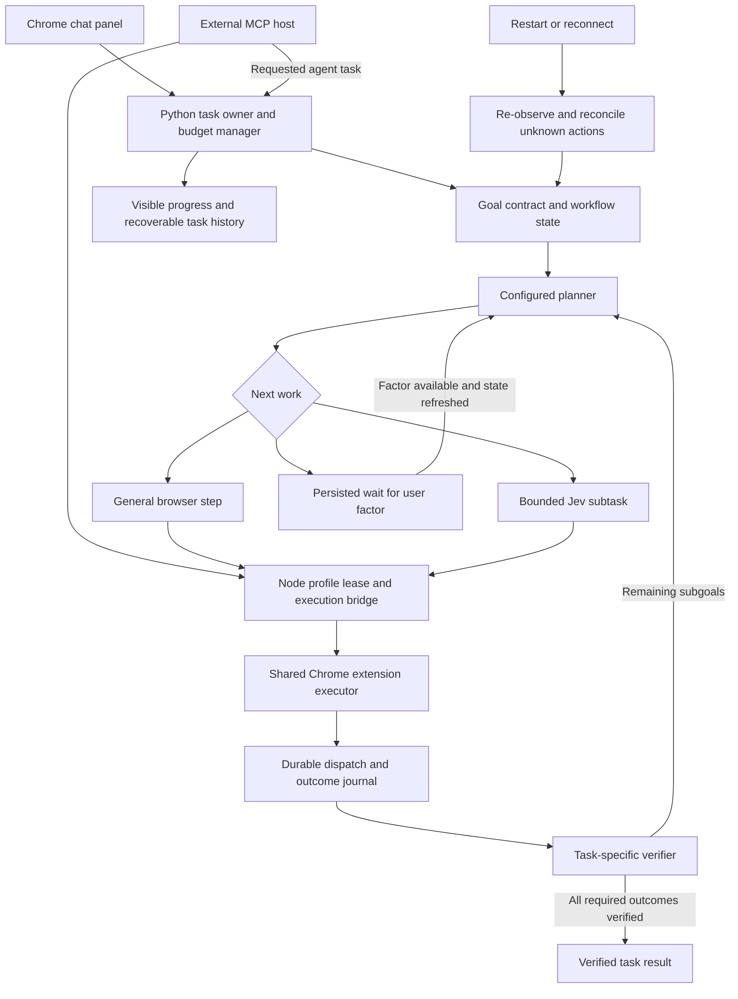

# JEV Browser agent development plan

Created: 6 October 2026. Source baseline: v0.4.1.

**Current stage: research and architecture discussion.** The user requested planning and questions before implementation. Only planning documentation has been changed in this round. No framework migration, feature implementation, configuration change, live browser task or new provider evaluation has started.

This is the central register for the next agent work. It complements the broader [roadmap](ROADMAP.md), the [source audit](AGENT-AUDIT-2026-10-06.md), the [framework comparison](FRAMEWORK-COMPARISON-2026-10-06.md) and the [evaluation program](AUTONOMOUS-BROWSER-EVALUATION.md). Earlier reports are historical evidence; planned features are not current capabilities.

## Proposed core architecture

User constraints confirmed on 6 October 2026: **Python for agent orchestration, personal use, and all three execution modes: direct MCP, bounded Jev and general LLM chat**. These choices do not authorize implementation yet or accept a particular framework.

Recommend **Python LangGraph** for orchestration, subject to the compatibility and evaluation gates. Retain the Chrome MV3 JavaScript extension, Chrome APIs/CDP executor, existing Node bridge/MCP interface and bounded Jev implementation initially. This is a Python agent backend with a reused Node execution service, not a full conversion of every component to Python. Preserve current provider behavior through an adapter during the experiment. The Node bridge remains the authoritative browser/profile lease and action-dispatch boundary; Python owns workflow state and budgets. No competing controller should own the same profile.

SQLite is the proposed local checkpoint/journal storage candidate for personal deployment; validate its crash behavior, retention and versioned migrations before acceptance. No hosted service or multi-user infrastructure is needed for the initial target. The exact framework/database versions and inter-process transport remain proposed.

Separate user intent, workflow state, action dispatch facts and outcome verification. A planner should choose subgoals and tools; an executor should enforce grounded inputs; a verifier should check task-specific results; a reconciler should inspect interrupted operations before further input. These can be separate components without multiple independent LLM agents or competing browser controllers.

Proposed logical flow:



This diagram is a proposal. The current system does not yet contain this structured workflow, independent verifier or restart scheduler.

## Architecture decision record ADR-001

Status: **framework proposed / user runtime, deployment and mode constraints confirmed / future experiment pending**.

Problem: add bounded delegation, complex cross-site authentication and restartable unattended execution without losing the working executor or falsely claiming browser outcomes.

Recommendation updated after the user's answers: favor Python LangGraph, with CrewAI Flows as the Python alternative and the current custom Node agent as a measured baseline/rollback path. LangGraph's explicit graph/state/interrupt mechanisms fit our deterministic browser steps, bounded Jev subtasks and verification checkpoints. Python preference removes the earlier Node-only integration advantage for LangGraph.js, but does not prove a performance improvement. The earlier JS-first recommendation is superseded for this personal Python architecture. Primary sources and qualifications are in the [comparison](FRAMEWORK-COMPARISON-2026-10-06.md).

Consequences if accepted: new orchestration/state interfaces and persistent storage, incremental wrappers around current modules, a versioned state migration and a rollback path. Browser actions remain behind our own journal and ownership controls. A graph checkpointer cannot make a website mutation exactly once.

Recorded decisions:

| Decision | User answer / interpretation                              | Current status                                    |
| -------- | --------------------------------------------------------- | ------------------------------------------------- |
| D-01     | Python agent orchestration                                | Confirmed preference                              |
| D-02     | Personal use                                              | Confirmed; machine uptime is not established      |
| D-03     | Direct MCP, bounded Jev and general LLM chat              | All three modes explicitly confirmed              |
| D-04     | Python LangGraph rather than CrewAI Flows                 | Recommended; not yet accepted or implemented      |
| D-05     | Representative website workflows and duration/cost limits | Proposed cases below; final release scope pending |

The answer to D-03 specifies modes, not three website tasks. Do not attribute particular workflow choices to the user. Use the representative cases below for architecture discussion; choose exact supported sites, budgets and acceptance thresholds before live evaluation. Personal use does not imply an always-on machine. Do not finalize framework versions or hosted deployment from assumptions.

## Three execution modes and the Python boundary

| Mode               | Decision maker                                  | Proposed path                                                                        | Evaluation focus                                                                                                  |
| ------------------ | ----------------------------------------------- | ------------------------------------------------------------------------------------ | ----------------------------------------------------------------------------------------------------------------- |
| Direct MCP         | External host agent                             | Existing MCP → shared Node execution bridge → extension                              | Native actions, evidence, ownership and compatibility; no extension-side LLM/Jev key needed for direct primitives |
| Bounded Jev        | Supplied task constraints, code and Jev choices | Agent-task entry → existing bounded engine under the same profile lease → extension  | Exact values, explicit outcomes, confidence handback and bounded usage                                            |
| General chat agent | Configured generative model                     | Panel/MCP agent-task entry → Python LangGraph → general actions or bounded Jev child | Planning, delegation, verification, progress, memory and recovery                                                 |

All three use the same browser primitives and profile ownership rules. They are supported modes, not three agents that may simultaneously type into one profile. Direct MCP remains usable without starting the Python planner. Existing MCP agent-task calls need explicit dispatch adapters during migration, while primitive calls keep their contracts.

Proposed inter-process contract: task/parent/subtask ID, profile lease identity, canonical tool schema version, action ID, deadline, cancellation and typed receipts. Reuse JSON Schema exported from shared tools; validate Python state with appropriate typed models without maintaining divergent tool definitions. The bridge enforces access and lease ownership. Python consumes durable action receipts for reconciliation; loss of either process must not cause blind action replay.

Keep the bounded engine in Node for the first integration experiment and call it through an internal parent-lease-aware operation. Do not recursively call the public MCP fast-task starter while the parent owns the browser. Provider-session/tool-call conversion, progress propagation, process cancellation and a single user-facing startup command are prototype acceptance requirements. This hybrid adds a process boundary whose latency and failure behavior must be measured.

Proposed representative cases: direct MCP opens/reads a grouped tab and returns a screenshot; bounded Jev fills supplied values and verifies the exact saved record; general chat creates project Orion, delegates eligible work and verifies the actual new record. Authentication fixtures and interrupted long tasks extend these cases later. These are proposed tests, not live tasks currently authorized or user-selected website workflows.

## Task register and dependency order

All implementation rows below are proposed or deferred. “Ready” is not implied by inclusion in this plan. The repeated delegation text in user item 3 is tracked once; new skills/tools are tracked separately for later work.

| ID         | Work                                                                    | User items | Status                                                   | Depends on                                                          | Acceptance evidence                                                     |
| ---------- | ----------------------------------------------------------------------- | ---------- | -------------------------------------------------------- | ------------------------------------------------------------------- | ----------------------------------------------------------------------- |
| ARCH-01    | Framework research/comparison and decision gates                        | 1          | Python/personal/three modes confirmed; framework pending | D-04, D-05                                                          | Comparison, recorded decision and later matched experiment              |
| EVAL-01    | Autonomous evaluation manifest, grader and baseline                     | 4          | Design documented; implementation proposed               | Architecture agreement                                              | Separate panel/MCP/Jev results, held-out cases, failure receipts        |
| VERIFY-01  | Task-specific goal verification                                         | 5          | Proposed; highest correctness priority                   | Goal contract, EVAL-01 smoke harness                                | Welcome/wrong-record tests reject completion; valid outcomes pass       |
| JEV-01     | Parent planner delegates bounded subtasks                               | 2–3        | Proposed                                                 | Shared state/ownership contract, VERIFY-01                          | Real panel delegation/fallback, independent results and matched latency |
| AUTH-01    | Structured cross-site authentication workflows                          | 7          | Proposed                                                 | D-05, VERIFY-01, EVAL-01                                            | Correct identity/resource through SSO/email variants and handoffs       |
| DURABLE-01 | Long unattended work and restart recovery                               | 8          | Proposed                                                 | Architecture/storage decision, VERIFY-01, EVAL-01, journal contract | Restart/unknown-write/cancel cases and staged long-task soaks           |
| SKILLS-01  | More skills and browser/application tools                               | 3, 6       | Deferred by user                                         | Core architecture and workflow needs                                | App-specific held-out workflow evidence                                 |
| FUTURE-01  | Streaming, visual reasoning, semantic memory and advanced configuration | 6          | Deferred by user                                         | Core decisions and measured needs                                   | Capability-specific evaluations, not generic feature claims             |

Suggested implementation order after discussion: shared contracts and baseline → verification → Jev delegation → authentication → durable long-work release. The framework experiment belongs before committing orchestration dependencies; evaluation and contracts should be portable across both candidates. Authentication and durability share state/journal design and can be staged together; overnight release waits for correctness and recovery evidence.

## VERIFY-01: goal contracts and outcome proof

Define required outcomes before executing: intended account/workspace, object identity, requested fields, allowed side effects, baseline where relevant and acceptable proof. Version the contract; user corrections may revise it and invalidate completed subgoals. Planner-generated predicates cannot silently weaken the original goal.

Use typed conditions for exact records and fields, authenticated identity, created resource metadata, downloaded artifact content, requested spreadsheet cells/formulas and cited research facts. Prefer independent application/backend checks where available and authorized. Otherwise use fresh, entity-specific observations, read-back/reopening and corroborating evidence. Do not require APIs that a site does not expose, and do not treat a generic page excerpt as sufficient proof.

Example: create project Orion requires proof of the intended Orion record in the intended workspace, with its requested attributes and new-record evidence when creation is required. Welcome to the workspace establishes none of those facts. A read-only goal or ensure-exists request may succeed without writes; this must be distinguished from create-new intent.

Represent all required conditions as verified/unverified/contradicted, with evidence provenance and freshness. Proposed user outcomes: completed, partial, unverified, blocked, cancelled and failed. `completed` requires all mandatory postconditions. A model assertion or a second LLM judge alone cannot attest to a persisted mutation. Credential delivery proof must avoid storing the key/OTP in public evidence.

The audit defect remains unfixed during this planning round. Preserve its [probe receipt](report-assets/agent-semantic-verification-audit-2026-10-06.json) as the first regression case.

## JEV-01: automatic bounded delegation

Expose a validated planner subtask operation with exact supplied values, allowed click labels, target tab/frame, narrowly defined scope, success contract and bounded steps/requests/time. Route only eligible tasks whose values and outcomes are known. Jev remains a choice engine over code-generated candidates; it does not generate missing credentials, arbitrary text or an unrestricted plan.

Invoke the bounded executor **inside the parent task's ownership context**. Do not have a running planner call its own MCP fast-task endpoint to start another controller; the current controller is already occupied. The existing `executeFastTask` accepts task, ledger, signal, checkpoint and event hooks, making an internal adapter plausible. Its current task-mode/usage mutations need a child result/state object instead of overwriting the parent task.

Required child contract: parent/subtask ID, spec/goal-contract version, inherited site access and cancellation, budget allocation, action receipts, latest observation, usage and typed result. Charge every child request/action/wait to both its bounded limit and the remaining parent budget. Persist child boundaries, publish real progress in chat and preserve user corrections during execution. No recursive unbounded delegation or concurrent foreground controllers.

On success, recheck child conditions and feed evidence into the parent verifier; child success alone cannot complete the whole task. On needs_plan/low confidence/unsupported controls, hand current observations back to the general planner. On unknown mutation outcome, reconcile first; never turn an uncertainty into an automatic retry. Test fallback, cancellation, goal updates and a missing Jev service alongside fast success.

Speed acceptance uses the same tasks with delegation on/off, including setup, parent planning and final verification. Keep direct MCP fast-run compatible for external hosts.

## AUTH-01: complex login and account setup

Use structured authentication state: identify account/provider → inspect existing session → choose supported sign-in → track popup/redirect → collect an available email factor → verify identity → perform the requested account action → independently verify resource/result. These states must remain explicit rather than living only in conversation prose.

Cover Google/Microsoft SSO where used, existing sessions, account selectors, vendor email/password, email OTP/magic links, onboarding and logout/expired sessions. Correlate messages by intended address, vendor, request time and current flow; match OTP lifetime and destination origin. Keep vendor and mailbox tab roles distinct. Resolve stale links, repeated codes, wrong-account choices and delayed messages without repeatedly resending or creating resources.

Passwords, tokens and ephemeral factors should use opaque references/short-lived memory and appropriate secret storage, not ordinary checkpoint text. Loading a mailbox or website must not allow its content to change the task or disclose unrelated data.

Passkeys, authenticator/device approval, inaccessible email and security challenges become durable user-factor handoffs when no supported factor is available. Resume after fresh state/identity checks. This plans broader authorized authentication workflows; it does not create authentication bypass capability. Existing session/user authorization should be reused rather than asking again unnecessarily. Separate fully unattended and assisted completion in evaluations.

Start with the website workflows selected for release scope; the user has so far confirmed execution modes. Do not expand scope to changing account security settings or creating unrelated accounts merely to simplify automation.

## DURABLE-01: unattended work with restart recovery

Persist a structured subgoal graph, dependencies, outcome contracts, task status, remaining budgets, current model/context state, user updates, child executions, action IDs and evidence references. Use a versioned journal that is not limited to the current rolling 40-action context view. Keep bounded summaries for the model; authoritative history must outlive compaction.

Define transactional boundaries for local state, then dispatch actions with a recorded intent and settle them with receipts. A crash can still occur between browser input and receipt; no local database transaction covers that website operation. Extend safe durable receipts/reconciliation rather than claiming exactly-once execution. Persist sensitive action details through protected references or encrypted storage where necessary; retain the existing public-ledger argument redaction.

Recovery sequence: claim the intended profile/task lease → verify compatible versions → restore remaining budgets/cancellation/user-factor state → find current tabs by workflow role and fresh identity → obtain fresh refs/observations → reconcile in-flight actions → continue only verified remaining work. Chrome tab IDs and DOM references are not durable identities. Where supported, use backend idempotency keys; otherwise inspect actual records/effects. Unresolvable uncertainty requires handoff.

A scheduler/process supervisor, retry backoff, provider/site deadlines, disk retention and visible queue/resume history are needed in addition to a graph. The machine, Chrome profile and bridge must be available; a graph cannot work while the computer is asleep. State should survive disconnection even when immediate continuation is impossible. Authentication expiry or a missing factor should become a persisted waiting state, not a busy polling loop.

Track active execution time, total elapsed/wait limits, model/Jev requests and estimated cost across restarts. Restarts must not reset limits. Streamlined internal continuation should not require repeated user approval for already authorized steps, while cancellation must remain authoritative. Maintain one mutating controller per profile; independent tab reads can still overlap.

Release only after staged multi-hour and overnight runs with real work, independent grading and injected failures. A 12-hour schema maximum is a budget option, not existing reliability evidence.

## Deferred work boundaries

Structured workflow state and restart scheduling are pulled forward only as needed for the explicitly requested unattended work. Broader planning optimization, provider token streaming, demonstrated visual reasoning, semantic retrieval/contradiction handling, application expertise, advanced JavaScript/uploads and general recovery expansion remain later decisions. Skills should declare prerequisites, intended effects and verification recipes; adding instructions alone does not establish a capability.

## Documentation process from this point

Use this register as the entry point. Record each new request with a stable task ID, goal, status, dependencies, scope exclusions, acceptance checks and next action. Record architecture choices as ADR entries with proposed/accepted/rejected/superseded status, rationale, alternatives and user constraints. Date reports; keep the stable plan current.

Workflow: proposed → discussed/ready → in progress → evaluated → done. Deferred and blocked are explicit alternatives. Planning documentation can be complete while its implementation remains proposed. A task reaches done only when required acceptance evidence exists; changing code or producing a demo alone is not sufficient.

For each implementation round:

1. Update the task card and relevant ADR before changing the selected component.
2. Define the baseline and acceptance checks; preserve the original failing case.
3. Implement within the agreed scope and record actual issues/tradeoffs.
4. Run the appropriate evaluation lane; attach redacted result receipts, version/model/conditions and failure denominators.
5. Update the current architecture/validation documents, close only proven items and link the next unresolved work.

Suggested task-card template:

```markdown
### TASK-ID — concrete outcome

Status: proposed | ready | in progress | evaluated | done | deferred | blocked
User intent and agreed scope:
Architecture decision / dependencies:
Baseline and failure evidence:
Acceptance checks:
Implementation notes and unresolved risks:
Evaluation conditions and result receipt links:
Next action:
```

Do not put API keys, pairing tokens, passwords, OTPs or personal mailbox content in these documents. Historical reports remain intact; later corrections must link back to earlier evidence. Future framework or workflow decisions should update this plan so a new session can see what is decided, pending and deferred without reconstructing chat history.
