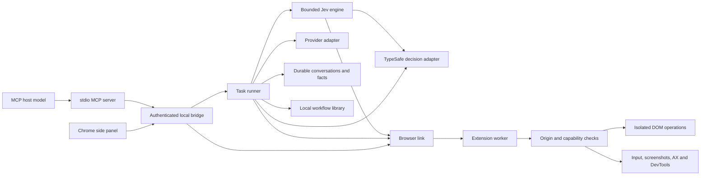

# Architecture

The browser extension is the final authority for website access. All browser actions, whether selected by an external MCP model or by the built-in task runner, use the same validated command vocabulary.

## Ownership

| Module                     | Responsibility                                                                                  |
| -------------------------- | ----------------------------------------------------------------------------------------------- |
| `shared/tools.mjs`         | Schemas, tool descriptions, exact-origin access rules                                           |
| `extension/background.mjs` | Worker lifecycle, authenticated bridge connection, privileged panel messages                    |
| `extension/browser.mjs`    | Tool dispatch, browser APIs, native input, debugger lifecycle, audit metadata                   |
| `extension/frames.mjs`     | Nested-frame geometry, source matching and parent occlusion checks                              |
| `extension/dom.mjs`        | Self-contained isolated-world observation, references, target validation                        |
| `extension/groups.mjs`     | Native named Chrome tab groups, membership validation and per-window default reuse              |
| `extension/access.mjs`     | Persistent broad-access preferences, temporary overrides and site blocks                        |
| `extension/panel.mjs`      | Pairing, provider setup, grants, chat, memory, pause and export                                 |
| `server/security.mjs`      | Authentication helpers, endpoint restrictions and upload-root validation                        |
| `server/browser-link.mjs`  | Correlation, timeouts, per-tab locks and validated parallel batches                             |
| `server/bridge.mjs`        | Loopback API, authenticated WebSocket, controller/task ownership                                |
| `server/provider.mjs`      | Responses, Anthropic and Chat protocol serialization; reasoning/tool-result continuity          |
| `server/fast-engine.mjs`   | Caller bindings, candidate compilation, inference gates and independently checked bounded tasks |
| `server/jev-contract.mjs`  | Typed questions, correlated answers and distribution validation                                 |
| `shared/protocol.mjs`      | Shared browser protocol compatibility version                                                   |
| `server/jev.mjs`           | Typed decision requests, distribution validation and confidence gates                           |
| `server/agent.mjs`         | Observe/act loop, budgets, cancellation and cited final evidence                                |
| `server/session-store.mjs` | Atomic private conversation, task and explicit-fact checkpoints                                 |
| `server/skills.mjs`        | Path-confined local workflow library                                                            |
| `server/tool-results.mjs`  | Image extraction, including batch images, for provider and MCP transport                        |
| `server/settings.mjs`      | Validated settings and local secret storage                                                     |
| `server/mcp.mjs`           | MCP SDK registration, annotations and image results                                             |

Browser UI, provider-specific wire formats, DOM code and transport framing do not share mutable implementation internals. Schemas are reused and bundled into the extension. The lockfile records reproducible dependency versions. JavaScript ESM keeps the initial build small; Zod validates external input at both bridge and extension boundaries.

## Transport decisions

Local WebSocket is used for development rather than a native-messaging installer. Authentication occurs in the first frame so tokens are not put in URLs. Requests are identified independently from tool names. The HTTP API is a private local bridge, not an MCP HTTP endpoint; stdio MCP is provided by the official SDK.

Chrome worker reconnects are triggered by alarms; WebSocket heartbeat traffic keeps an active connection alive on supported Chrome versions. Origin grants survive worker suspension in session storage. Queued commands must belong to the active socket and be within their deadline. Browser disconnects never cause automatic replay. One attached extension profile is allowed so tab IDs from different profiles cannot be mixed.

The task runner and external commands are exclusive. A multi-step task owns the browser until it completes, fails or finishes cancellation. External clients receive a busy error while another controller is active. Within one controller, `browser_batch` overlaps independent operations on distinct tabs. Input schemas and local upload paths are checked before dispatch; per-tab locks and worker queues prevent same-tab overlap. A batch is not atomic and returns each result independently. Provider calls may retry transient rate-limit/service statuses; browser mutations do not retry.

## Observations and native input

Compact DOM snapshots prioritize visible main-task text and viewport controls, support scope/name/role filters, and contain visible text and 150 interactive elements by default (configurable to 500). References bind to actual nodes in Chrome's isolated world and are replaced on each snapshot. Detached nodes or references from old snapshots fail before input. Unique selectors traverse open shadow roots. Targets are checked for visibility, disabled state and occlusion.

CDP provides trusted input and screenshots. Dialog-opening events can resolve an input operation before the underlying CDP command finishes, allowing a following dialog tool to release it. This avoids deadlocking the command queue on `confirm()` or `prompt()`.

Frames are listed by Chrome's frame ID and checked separately for DOM operations. A bounded main-frame accessibility tree supplies roles, names, relationships and selected properties; textbox values are omitted. An isolated-world frame relay maps child points to parent coordinates recursively, including cross-process frames. It matches a trusted message source to the actual iframe owner and computes geometry itself; pages do not supply coordinates. Parent access and occlusion are checked, and unsupported transforms fall back to screenshot input. Coordinate tools operate against the main viewport; pixel content cannot be origin-isolated.

## Agent and Jev

The LLM retains planning and argument generation. Jev asks narrow closed-choice questions about observation strategy and element matching. Criteria contain candidate descriptions rather than executable snippets. Invalid distributions, out-of-set choices and low confidence never trigger an automatic click or grant.

The provider conversation retains its protocol's tool-call correlation and, for Responses, opaque reasoning output. Page data stays in observation/tool-result content, separate from the system's permission instructions. Screenshot content is attached as an image, not dumped as base64 text. Text-context budget is measured separately from image bytes.

The task runner allows one tool call per model turn, with a batch tool for independent tabs, bounds duration and steps, compacts long context, tracks consecutive errors and rejects repeated identical mutations. Successful final output must cite a real excerpt from the latest snapshot. Semantic goal verification and image-based proof remain separate work.

## Trust limits

A compromised authorized page can still influence a model. Origin scoping and untrusted-data prompts reduce exposure without proving prompt-injection immunity. Website access is not a network sandbox. Advanced evaluation may run arbitrary page JavaScript; file upload adds a local filesystem-to-page boundary. Both are separately gated and need production review.

Secrets use a local file rather than browser storage. File permissions do not encrypt them. A future desktop/native host should use the OS keychain, exact extension-ID pairing and a signed installer. Conversations and task outcomes persist locally. Restart marks running tasks interrupted without replay. Model history is checkpointed only at completed tool-group boundaries so unmatched tool calls are not restored. The next task observes the browser before taking an action.

## Durable sessions and compaction

The session store serializes read-modify-write operations and writes UUID-scoped JSON through owner-only temporary files and atomic renames. Human-readable transcripts, summaries, facts and task outcomes are separate from provider wire history. Public session export omits that wire history. Fact creation is explicit; the planner has read access but cannot automatically create reusable facts.

Compatible provider/model sessions restore paired tool history. Universal compaction makes a separate no-tools summary request, then pins the current goal, recent corrections and bounded recent observations. Responses can instead use its native compaction endpoint; canonical output is preserved intact. Images are delivered as image blocks, including multiple batch screenshots, and previous ordinary images are omitted from later checkpoints. Native canonical history is exempt from pruning. A checkpoint size or compaction failure stops progress instead of silently discarding state.

Memory is context, never a capability grant. Origin preferences stay in trusted Chrome local storage, effective grants stay in session storage, and access is checked again during every browser operation. Restart recovery records uncertainty; it does not infer that an action succeeded.

## DevTools observations

Diagnostics must be started before reproduction. Console and network metadata are bounded in memory and reset on debugger detach. Request headers, POST data and cookies are not captured by this tool; recorded URLs drop query/fragment credentials. Response bodies require advanced access and a captured completed request whose final origin matches the current authorized tab. Performance and viewport tools use named CDP methods rather than an unrestricted protocol passthrough.

## Broad access and browser APIs

The manifest requests all HTTP(S) host permissions at installation/update. Broad read/interact access is enabled by default, with no per-site prompt or expiry. Its enabled/advanced preferences and explicit site blocks persist in trusted local storage; worker/browser startup restores effective grants into session storage. Optional site overrides expire after one hour. Only the trusted side panel can modify access; model commands cannot grant it. Explicit origin scopes and blocked origins take precedence. Pause applies to broad access too. Capability introspection remains available while paused.

Named window/tab tools use Chrome APIs. Managed downloads skip Save dialogs, track completion and expose pause/resume/cancel/reveal operations only for downloads started by this tool in the same tab. Download and window-management commands are excluded from tab batches because they share browser-wide state. Audit writes are serialized; an audit-storage failure does not convert an already successful action into a retryable action error.

## Visible tab groups

`browser_open` groups new tabs under **JEV Browser** (purple) by default. Per-window group IDs are retained in trusted session storage so worker suspension and renaming do not create duplicate groups. A missing/closed/inaccessible group is replaced; after a browser restart, an accessible group with the default title can be reused. Group creation and metadata updates are separate Chrome operations: once opening/grouping succeeds, a later metadata failure returns the known IDs and a warning rather than replaying the mutation.

Explicit grouping, group listing and title/color/collapse updates use named Chrome APIs. Every existing member is checked before a group-wide mutation. Group tools are excluded from independent tab batches because membership and window layout are shared state. Existing user tabs are not automatically regrouped.

## Verified actions and extraction

`extension/step.mjs` holds the outer tab queue while performing one mutation, an optional explicit predicate wait and a fresh scoped observation. Optional foreground activation precedes the goal action and is rejected in parallel batches because active-tab state is shared. Stage timings expose activation/input/wait/observation costs. Structured partial outcomes preserve completed input when subsequent verification fails. `extension/form.mjs` validates all independent native fields before input, then validates and verifies each field as it executes. It never submits or rolls back. Cascading fields require separate operations.

The isolated DOM layer provides bounded text/table/link/image-metadata extraction. Main-frame trusted input remains fast; framed reference clicks await a rendered compositor frame through a discarded CDP screenshot, then recompute validated geometry before a single input sequence. This mitigated the observed cross-process hit-test race without replaying input.

## Tool categories, task ledger and workspace

The built-in provider exposes a core tool surface and a `browser_toolset` category loader. Categories persist in provider checkpoints and expand definitions on the next request; advanced definitions remain gated. The context estimate includes system instructions, definitions and textual history, separately from image bytes.

`server/task-ledger.mjs` records a bounded, argument-free action ledger. A dispatch record is persisted before mutations; return records distinguish observed results and unconfirmed outcomes. Restart marks unfinished dispatches unconfirmed, keeps the goal and recent user corrections, and never automatically replays them. The ledger improves factual continuity; it is not semantic proof of task success.

The panel uses Chat/Activity/Memory/Settings views with a bundled font and no external asset requests. Authenticated `/workspace` returns combined conversation/task state with a monotonic revision and at most 50 transcript messages. Unchanged revisions omit transcript messages; export preserves complete history. Polling slows when idle/hidden. Conversation state omits provider wire history before cloning public views.

Protocol 4 authentication includes the worker version. Legacy workers remain paired but are not command-ready: the bridge returns `EXTENSION_UPDATE_REQUIRED` before dispatch. A one-time extension reload activates the new build without discarding pairing.

Stored provider keys carry endpoint/protocol identities, preventing accidental reuse after an endpoint change. Environment-key identity is captured at process start; deployment environment changes still require deliberate operator configuration. Owner-only local files remain unencrypted.

## Optimizations in 0.3.0

Main-frame typing validates geometry, occlusion and focus in one isolated invocation, then uses trusted native input. Empty inputs skip select-all; nonempty replacements and framed ancestor checks remain. Focus redirects or replaced targets fail before text insertion.

Form preparation returns only a boolean value match. Matching native text/select fields skip input by default and remain independently verified; callers can opt into repeated events. Disabled optgroup options are rejected and marked in observations.

Wait polling runs in the extension worker: 50 ms sleeps during the first 500 ms, then 200 ms, always bounded by the remaining timeout. Every probe rechecks access/navigation. Selector conditions support visible/hidden/attached/detached; scoped selector/text predicates combine. No long-lived page observers or background-page timer dependency is introduced.

Static provider JSON schemas and selected tool surfaces are immutable and cached. Text budget accounting reuses their exact serialized character count. Permissions, observations, tab state, provider keys and mutable history are never cached through this mechanism.

PNG remains the screenshot default; optional JPEG quality is passed through the named Page.captureScreenshot operation. MIME types are preserved in MCP and all provider adapters. Optional includeFrames:false omits frame metadata; the standard snapshot retains frame discovery.

## Bounded Jev mode in 0.4.0

`POST /fast-tasks` and MCP `browser_fast_run` start the same TaskRunner ownership lifecycle without constructing a ProviderSession. Fields bind by unique normalized native labels; code supplies the exact values and compiles eligible ref-based clicks. Supplied fields must be supported and satisfied before a click is offered. Jev sees opaque action IDs, row context and verified field checks, not executable arguments. Typed response validation and separate confidence/probability gates precede guarded input. Caller success predicates are checked against fresh snapshots. Uncertain input stops; one transient inference deadline can refresh and retry within existing budgets.

Conversation and reusable facts remain bounded fallible context. An update during inference or checkpoint returns to the host before input; cancelling uses the same abort signal. Ledger dispatch markers are persisted before input and never contain field arguments. Final observations support deliberate host continuation. The side-panel provider runner and bounded MCP runner share ownership but are distinct execution modes.

Protocol 4 requires the 0.4.0 worker for row/target/related-field guard enforcement; protocols 1–3 remain paired but receive a reload requirement without commands. Review the [live report](JEV-LIVE-REPORT-2026-10-06.md) for failed iterations and actual API measurements.

## Startup, progress and recoverable input in 0.4.1

`server/startup.mjs` recognizes only an opening instruction at the beginning of the current user goal. Literal HTTP(S) targets and the audited NVIDIA NIM dashboard alias open through the normal browser/permission/ledger path before planner construction. A plain literal URL task completes without a provider request only after a fresh DOM read verifies its exact URL and page title. Compound goals continue with the new tab and an explicit startup receipt. Ambiguous targets and other goals retain model planning.

Task progress is a server-owned stage with timestamp, accompanied by bounded progress events. The panel shows submission feedback immediately, then the current stage, elapsed time and recent stages in chat independently of saved conversation revisions. Running tasks poll every 800ms; no provider output is fabricated while inference is pending. General observation routing has a 1500ms total request budget, and known occlusion forces a screenshot even if routing fails.

Only the preparation before native click/hover/text input may label an error `not_dispatched`. The first native input command ends that boundary. Compound steps return `action_blocked` plus a fresh read for a proven pre-input failure; unknown errors retain `unconfirmed`. This metadata survives direct tool transport. The general planner may inspect and handle the observed overlay with fresh targets; bounded Jev tasks return `needs_plan`. Neither path retries input automatically. Field receipts preserve earlier completed fields independently of the blocked current field.

The browser protocol remains 4: the new receipt is additive, and older workers cannot claim it. Reload the extension once to activate the new panel and worker.
