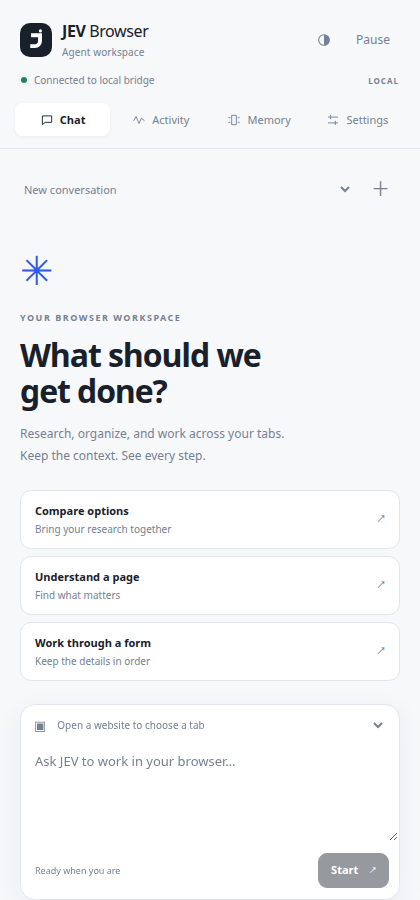
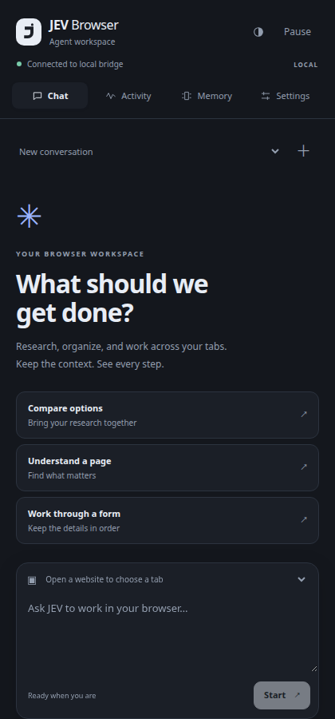

# JEV Browser 0.2.0 — autonomous improvement report

**Delivered:** a substantially improved Chrome extension, local bridge and 49-tool MCP server, with a redesigned UI, measured transport/context improvements, verified compound actions, structured extraction and durable execution memory. This is a tested engineering release, not a claim of being better than Claude or every browser agent.

## Run scope and time

Started **5 October 2026 at 18:13 IST** (12:43 UTC). Report prepared at **2026-10-05 19:46 UTC** after approximately **93 minutes** of active research, implementation, measurement and regression work. The requested overnight work was carried out as an autonomous improvement run and completed when the concrete release and validation were ready; this was not an unattended all-night soak. No paid model calls, credit purchases or additional personal-account actions were performed during development.

The user's earlier Claude chat, image retrieval, visible tab-group and TypeSafe Google onboarding tests established that the previous extension could operate the signed-in profile. Improvement tests used disposable Chromium profiles and local fixtures, keeping private tabs and account data out of the corpus and packages.

## Why the earlier process felt slow

There are several separate costs:

1. The demonstration helper started a new MCP process for each call. The measured startup/handshake path costs about 220 ms; a connected client returns status in about 3.5 ms. Normal MCP hosts already keep their connection open; the new JSONL helper does too.
2. Large snapshots consumed unnecessary model context and sometimes omitted the actual form. The baseline's 1,000-link sidebar crowded out the main task. Task-first selection, compact output and scoping fix that observation failure.
3. Separate action, wait and observation calls create additional model turns. Compound tools reduce these turns and expose partial outcomes, but their added preflight/verification work can be slower inside the browser.
4. Waiting for every resource can delay an otherwise usable page. Explicit text/selector predicates and DOM-content readiness now avoid that unnecessary dependency.
5. Some background-tab pointer actions have a one-second tail in this Chromium fixture. A matched foreground experiment reduced that tail substantially. The new foreground option uses normal Chrome tab activation before input.
6. Model reasoning, provider network time and real-site login verification also contribute. We did not separately time those in the personal-account demonstration, and no configured live model key was available for a fair end-to-end comparison with Claude.

The release therefore records model time separately from tool time, and compound actions expose activation/action/wait/observation timings. Future optimization can target the actual slow stage instead of guessing.

## Measured browser/transport results

Conditions: Node **24.19.0**, Chromium **153.0.8010.12**, one local bridge, actual unpacked extension and official SDK stdio MCP client. The microbenchmark has 1,000 sidebar links and a two-field form, with 10 samples per operation. Median/p95 values describe this machine and fixture; they are not statistically significant estimates for all websites. Cold status includes client startup/handshake/cleanup. Mutations are sequential and never retried.

| Operation                                    | Baseline median / p95 ms | Final median / p95 ms | Final result bytes |
| -------------------------------------------- | -----------------------: | --------------------: | -----------------: |
| Persistent MCP status                        |              3.50 / 4.25 |           3.50 / 4.33 |                131 |
| Fresh client + handshake + status            |          216.56 / 224.36 |       219.74 / 226.90 |                131 |
| Default full snapshot                        |            23.46 / 36.30 |         25.30 / 33.62 |             33,696 |
| Type + default full snapshot                 |            35.79 / 55.40 |         40.47 / 50.67 |             33,724 |
| Scoped main-form snapshot                    |             Not measured |          8.67 / 12.61 |                835 |
| Separate type + scoped snapshot              |             Not measured |         21.44 / 22.53 |                835 |
| Compound type + scoped snapshot              |             Not measured |         25.48 / 28.03 |              1,025 |
| Two individual fields + scoped snapshot      |             Not measured |         38.25 / 39.72 |                861 |
| Preflighted two-field form + scoped snapshot |             Not measured |         50.43 / 52.88 |                992 |

Default snapshot size changed from **64,650 to 33,696 bytes**, a **47.9% reduction**, and the main task became visible. This changes the default control cap from 250 to 150 as well as prioritization and metadata; it is not lossless compression of identical observations. The scoped main-form snapshot is **835 bytes** because irrelevant regions are deliberately excluded. The final full-page snapshot and raw full action/observe path were slightly slower than baseline; no general browser-action speedup is claimed.

Matched scoped comparisons also show the verification tradeoff: separate type/read is 21.44 ms versus 25.48 ms compound; two individual fields/read is 38.25 ms versus 50.43 ms preflighted form. Their benefit is fewer agent turns, more predictable verification and explicit failure accounting. A live model benchmark must establish the eventual task latency/cost benefit.

Raw evidence: [baseline](report-assets/benchmark-baseline.json), [final microbenchmark](report-assets/benchmark-release-final-v02.json), [intermediate style-cache iteration](report-assets/benchmark-cached-styles-v1.json).

### Background input investigation

The same 20 form workflows and seed were run sequentially in background and foreground modes. Each includes a server-controlled 25–225 ms confirmation delay and an independent record check.

| Metric                                |           Background |         Foreground |
| ------------------------------------- | -------------------: | -----------------: |
| Click action median / p95             |  15.10 / 1,028.20 ms |   18.90 / 29.00 ms |
| Complete compound action median / p95 | 238.90 / 1,250.38 ms | 240.81 / 285.31 ms |
| Entire form workflow median / p95     |       433 / 1,425 ms |       446 / 497 ms |

Foreground activation avoids the measured tail; it does not improve every median. The compositor/scheduling explanation remains an inference. Chromium routes pointer events through asynchronous widget hit testing, but we have not established an upstream root cause for this exact delay. [Chromium input implementation](https://raw.githubusercontent.com/chromium/chromium/main/content/browser/devtools/protocol/input_handler.cc).

A subsequent 100-workflow release run used `browser_step foreground:true` on previously background tabs: all 103 cases passed; activation p95 was 14 ms and click action p95 31 ms. Complete workflow p95 was 624 ms for this different seed, so it is a confirmation run rather than an equal-seed comparison.

[Background stages](report-assets/evaluation-stages-v02-20261006-20.json), [matched foreground run](report-assets/evaluation-foreground-v02-20261006-20.json), [100-workflow foreground-step release run](report-assets/evaluation-foreground-step-release-v02-20261007-100.json).

## What changed

| Layer               | Delivered behavior                                                                                                                                                                              |
| ------------------- | ----------------------------------------------------------------------------------------------------------------------------------------------------------------------------------------------- |
| MCP transport       | Persistent JSONL client with request IDs, elapsed time, bounded input, clean EOF and images saved outside JSON/base64 text                                                                      |
| Observations        | Compact task-first snapshots; scope/name/role/viewport filters; implicit roles; fresh actual-node refs; open-shadow traversal; ancestor visibility and label fixes; per-operation style caching |
| Structured data     | Bounded text, tables, links and image metadata; scoped/open-shadow extraction; no unrestricted JavaScript required                                                                              |
| Actions             | One-action/wait/observe compound with stage timings and partial outcomes; explicit foreground activation; no action replay                                                                      |
| Forms               | Up to 20 independent native fields preflighted before input; text/select/checkbox support; per-field verification; no implicit submit or rollback                                               |
| Readiness           | Meaningful selector/text predicates independent of unrelated resources; explicit DOM-content/complete states                                                                                    |
| Frames              | Nested/scaled cross-site geometry checks plus render synchronization before a single trusted click; parent access/occlusion rechecks                                                            |
| Files/popups        | Managed download terminal-state waiting with ownership checks; popup discovery through openerTabId; explicit task-group adoption                                                                |
| Planner context     | Portable progressive tool-category loading, persisted categories and system/definition/history context accounting                                                                               |
| Long sessions       | Persisted dispatch/return ledger, goal/corrections, restart uncertainty; explicit reusable facts; configurable duration/step/context budgets                                                    |
| Credentials/version | Stored keys bound to destination/protocol; environment binding during process lifetime; stale-worker negotiation that prevents dispatch until reload                                            |
| UI/data transfer    | Chat/Activity/Memory/Settings, local Inter font, themes, keyboard navigation, 320 px review; combined conditional workspace polling and bounded transcript transfer                             |

The built-in planner's core definition surface is **23 tools / 21,955 bytes**, compared with **37 / 30,409 bytes** for its non-advanced full surface: about **27.8% fewer definition bytes**. This includes planner/memory extras and differs from the direct MCP's 49 tools. Category loading is portable and implemented here; it is not vendor-native Tool Search. Loading tools never changes access. The live reasoning/quality tradeoff is unmeasured.

Task limits remain bounded: defaults are 40 steps and 10 minutes; configurable ceilings are 2,000 steps, 12 hours and 2,000,000 text characters. Provider context limits and checkpoint limits still apply. The panel transfers the most recent 50 transcript messages; full conversation export retains older history. Facts across conversations are saved only explicitly.

## UI preview

The previous dense configuration page was replaced with a conversation workspace, a separate activity/evidence view and progressive settings. Typography is bundled locally with its license; no font CDN is required. Screenshots below contain fixture data only.

| Chat — light                                              | Chat — dark                                             |
| --------------------------------------------------------- | ------------------------------------------------------- |
|  |  |

[Completed fixture conversation](report-assets/side-panel.png), [Activity](report-assets/ui-activity-empty.png), [Memory](report-assets/ui-memory.png), [320 px Settings](report-assets/ui-settings-narrow.png).

## Issues encountered and how they were handled

| Finding                                                             | Resolution / evidence                                                                                                                                                                                     |
| ------------------------------------------------------------------- | --------------------------------------------------------------------------------------------------------------------------------------------------------------------------------------------------------- |
| Main task omitted behind a large sidebar                            | Prioritize main text and viewport controls before bounds; baseline task was missing, final benchmark finds it                                                                                             |
| Piped requests disappeared during client startup                    | Create the input reader after MCP handshake; startup/invalid-line/EOF integration test preserves every request                                                                                            |
| Compound tools looked faster only when observation scope differed   | Added matched scoped comparisons; recorded extra verification overhead instead of claiming a false raw speedup                                                                                            |
| Waiting for unrelated slow images delayed useful controls           | Explicit predicates bypass resource-complete gating; actual browser fixture validates readiness before the slow image finishes                                                                            |
| Initial corpus failed 40/40 forms before input                      | Native select label included option text; remove nested controls from cloned label text; preserved initial 3/43 report, then two seeds passed 103/103 each                                                |
| Fresh nested iframe clicks intermittently missed                    | Explicit button state alone passed 20 samples but failed sample 42 in a 100-frame run; render synchronization plus fresh geometry then passed repeated 100-frame runs without replay                      |
| Some background clicks still took about a second                    | Added stage telemetry; a blanket screenshot experiment worsened overhead and was removed; foreground activation substantially reduced matched tail latency and now has an explicit sequential tool option |
| Focus changes could conflict in multi-tab batches                   | Reject foreground compound actions during batch preflight before any sibling dispatch; independent reads remain parallel                                                                                  |
| Download polling sometimes observed an unfinished transfer          | Added one bounded terminal-state wait with access/ownership rechecks; the original transient root cause is not established                                                                                |
| Crash boundaries were absent from conversation summaries            | Persist argument-free action dispatch before input and settled result after it; restart marks unfinished dispatches unconfirmed and never resumes them automatically                                      |
| Context estimate omitted mandatory instructions/definitions         | Include them in text accounting; update meaningful compaction assertions while preserving provider-native canonical output                                                                                |
| Switching endpoints could reuse a stored API key                    | Bind keys to endpoint/protocol identity, disable mismatches, test endpoint changes and restart; stored values never return through settings                                                               |
| Panel repeatedly copied/returned growing provider/transcript state  | Omit wire history before cloning; revisions and combined workspace response; bounded latest-message view and adaptive polling                                                                             |
| UI screenshots caught theme transitions mid-frame                   | Disable animation during capture; fresh light/dark/narrow previews reviewed with final styles                                                                                                             |
| Empty tab chooser implied a missing permission despite broad access | Distinguish no website tabs from disabled access                                                                                                                                                          |
| New bridge could send new arguments to an old worker                | Protocol/version negotiation reports EXTENSION_UPDATE_REQUIRED and sends no browser command until the worker reloads                                                                                      |
| Packaging could include private local artifacts                     | Reproducible allowlisted paths, symlink refusal, archive integrity/checksums; local config, raw artifacts and dependencies excluded                                                                       |

The first failed corpus and rejected screenshot experiment remain available for review: [label failure](report-assets/evaluation-20261005-40.json), [fixed seed](report-assets/evaluation-labels-fixed-20261005-100.json), [second seed](report-assets/evaluation-release-v02-20261006-100.json), [rejected background-render experiment](report-assets/evaluation-background-render-v02-20261006-20.json).

## Validation

- **53/53** unit/integration tests pass, including transport authentication, access boundaries, same-tab locks, unknown outcomes, form/step behavior, foreground batch rejection, provider formats, compaction, memory, endpoint-bound keys and stale-worker negotiation.
- Full production-manifest Chromium integration passes through the actual extension, bridge and official SDK MCP transport, including images, trusted input, forms, dialogs, upload/download, diagnostics, groups/windows, six-tab observations, pause/revocation and restart persistence.
- The final regression includes **100 fresh nested cross-site frame clicks**, each independently checked for one trusted delivery, with no action replay.
- Three post-fix 100-form runs each pass **103/103** cases: two background seeds and one foreground-step seed. These reuse task families, not 309 distinct real-world goals.
- Matched 20-workflow instrumentation/foreground experiments passed 23/23 cases each. Deterministic policies make **zero model calls**; graders inspect fixture server records, exact field values and exactly one trusted submission.
- Syntax, formatting, build and package checks are included in the release workflow. No Chrome Web Store publication, Windows/macOS test or enterprise-browser qualification was performed.

[Validation details](VALIDATION.md) describe scope and reproducible checks.

## Research and the path forward

The primary-source survey examined Playwright MCP/CLI, Chrome DevTools MCP, Stagehand, Browser Use, Skyvern, UI-TARS/UI-TARS-2, BrowserGym, WebArena/BrowserArena, Anthropic tool-loading/evaluation/injection work, Chrome APIs and TypeSafe Jev. The architecture decisions and direct source links are in [the research matrix](RESEARCH.md#comparative-primary-source-review-for-020). It is representative research, not an exhaustive claim to have read the entire field.

The resulting priorities were bounded observations, fewer model turns, deterministic execution boundaries, multiple complementary browser layers, independent grading and durable uncertainty. This release implements the browser/transport foundation and the measurement hooks. It does not prove that Jev improves reasoning or that a particular planner matches Claude.

Next release gates, in order:

1. Evaluate actual configured planners and optional Jev with equal budgets on diverse held-out task families. Measure independent completion, false success, unintended writes, interventions, latency, tokens/cost and memory fidelity.
2. Add authenticated original-image/PDF/document reading, broader editable widgets and full child-target diagnostics with dedicated fixtures.
3. Add explicit resumable handoffs and task-specific semantic outcome verifiers, then adversarial page/document tests.
4. Validate long-duration resource behavior, extension suspension/detach and 100+ heterogeneous workflows across Linux/Windows/macOS.
5. Build a signed native messaging/keychain companion for supported OS-owned surfaces, then review store distribution/privacy and enterprise policies.

Every current gap has a concrete route in [capability gaps](CAPABILITY-GAPS.md) and [the roadmap](ROADMAP.md). Browser-owned security UI, missing 2FA/CAPTCHA, protected pages, and closed-shadow/custom visual widgets remain explicit handoffs/fallbacks; universal bypass/control is not an implemented capability. No original image/PDF byte reader or native desktop companion ships in 0.2.0.

## Use the release

The built extension is at `dist/extension`; archives are `dist/jev-browser-extension.zip` and `dist/jev-browser-source.zip`, with sizes/SHA-256 values in `dist/release.json`. Extract the extension ZIP into a folder, then Load unpacked that folder; its manifest is at the archive root.

For the existing installation, the local bridge is updated to 0.2.0 and retains configuration/pairing/memory. **Click Reload once on the JEV Browser card in chrome://extensions.** The older worker is identified before dispatch; no re-pairing should be needed. Direct MCP control needs no Jev/provider API key. The built-in planner requires its configured provider/model/key. Restart/reconnect a host MCP client if it cached the old tool inventory.

Reproduce locally:

```bash
npm ci
npm run build
npm run check
npm run format:check
npm test
JEV_FRAME_SAMPLES=100 npm run test:e2e
npm run benchmark -- release-final-v02
JEV_EVAL_ROUNDS=100 JEV_EVAL_SEED=20261006 npm run evaluate -- release-v02
JEV_EVAL_FOREGROUND=1 JEV_EVAL_ROUNDS=100 JEV_EVAL_SEED=20261007 npm run evaluate -- foreground-step-release-v02
npm run preview:ui
npm run package
```

Use a persistent host MCP connection or `npm run session` for repeated commands. For visible compound input, supply `foreground:true`; leave it false for independent background work. One controller can overlap up to six independent tabs, but foreground/group/window state changes stay sequential.
