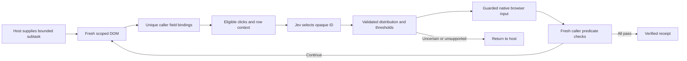

# Jev live tests and 0.4.0 implementation

6 October 2026, Asia/Kolkata. Tested with Node 24.19 and Chromium 153.0.8010.12, using the actual unpacked extension, local bridge, stdio MCP client and live provider APIs. Browser workflows ran exclusively in disposable profiles against local fixtures. No personal accounts, messages or live-site records were changed.

## Outcome

Keep one extension. The new `browser_fast_run` MCP tool executes bounded supplied-value subtasks through the existing controller, browser executor, ledger and conversation store. It needs Jev, but no separate generative LLM key. Direct MCP and the general provider runner remain available for host continuation.

The final development run completed **13/13 workflows**, independently graded against private fixture-server receipts, with **541.11 ms median** and **708.24 ms p95** workflow time. This is a small development corpus, not a held-out benchmark or evidence of Claude parity. One earlier release run completed 12/13 because a Jev request timed out; that failure is retained below.

Token Harbor is configured using Chat Completions and the user's requested **`deepseek-v4.1-flash:free`**. Its separate live planner run completed **3/3 native-form workflows**, with **52,218.14 ms median** and **110,618.67 ms p95**. Authentication and real tool calling worked. These timings describe this gateway/model and these fixtures; they do not predict another provider's latency. [Token Harbor API](https://tokenharbor.ai/docs/api/curl), [model discovery and billing](https://tokenharbor.ai/docs/api/models), [free-model policy](https://tokenharbor.ai/docs/getting-started/quickstart)

## What changed

- **Grounding:** optional bounded row/section context, enabled-control filtering and opaque candidate IDs. Literal, unique label matches use code, avoiding unnecessary inference. Duplicate labels retain their row context for Jev.
- **Typed adapter:** Choice, Noul and Score support, question/option coverage checks, finite probability distributions, selected-choice argmax validation, model/usage/timing statistics, and a total deadline across HTTP retries. Reported usage is counted even when a reply fails validation. The application batch cap is 64 questions; that is our limit, not a claimed vendor limit. [TypeSafe API](https://docs.typesafe.ai/api)
- **Bounded engine:** exact caller values, allowed click labels, explicit success predicates, step/request/time budgets, one controller, persistent action boundaries, cancellation and typed hand-back. The model selects an opaque ID; code supplies all executable arguments.
- **Input guards:** target name/context/value/checked checks before input. Submission clicks also recheck the supplied fields. This catches the tested changes during inference; it cannot make browser input atomic with a site's JavaScript or backend.
- **Transport recovery:** one inference timeout may retry after a fresh browser read within the remaining budgets. Browser input is never automatically replayed. Timeout usage is marked unconfirmed.
- **Visibility and diagnostics:** foreground form filling and clicks activate the tab; foreground work is excluded from parallel batches. Activity rendering supports Jev decisions and request/token/timing statistics. Failed asynchronous tasks now return readable MCP status receipts instead of turning the poll itself into a tool error.
- **Compatibility:** version 0.4.0 uses browser protocol 4. Older workers report `EXTENSION_UPDATE_REQUIRED`, so an older extension cannot silently omit new guard enforcement.

## Locator experiments, including failed iterations

The 32 cases comprise eight exact labels, eight duplicate-row controls, eight absent targets, four disabled targets and four open-shadow controls. An accepted ref was clicked once through the extension and graded from the fixture server's private receipt. Absent/disabled cases required abstention and zero clicks.

| Iteration                                  | Passed | Jev requests |    Median |         p95 | Known input-cost estimate |
| ------------------------------------------ | -----: | -----------: | --------: | ----------: | ------------------------: |
| Original 0.3 locator                       |  17/32 |           32 | 412.18 ms | 1,344.59 ms |              $0.000637644 |
| Context, opaque IDs and disabled filtering |  20/32 |           32 | 366.55 ms |   620.81 ms |              $0.000706608 |
| Context plus unique literal-label lookup   |  32/32 |           16 | 359.42 ms |   633.95 ms |              $0.000352800 |

The first change fixed all eight duplicate-row cases, but Jev abstained on exact/shadow cases at the unchanged 0.8 confidence gate. Deterministic literal matching solved those cases without weakening the gate. Therefore **32/32 is system coverage, not Jev-only semantic accuracy**. The final 16 model requests covered duplicate-row and absent-target decisions. Disabled selections in the original run were rejected by the executor; no wrong control was actually clicked.

Raw fixture results: [original](report-assets/jev-locate-baseline-v03.json), [context iteration](report-assets/jev-locate-context-v04-dev.json), [grounded iteration](report-assets/jev-locate-grounded-v04-dev.json). Timing covers locate, excluding navigation, later click and private grading.

## Multi-step workflow experiments

Every form submission had to contain all requested text/select/checkbox values and exactly one trusted submission. Duplicate-row cases required the correct record identity and exactly one trusted click. Shadow cases used actual open-shadow inputs. The already-complete page required zero submissions and zero inference requests.

| Iteration                                   | Passed | Jev requests |    Median |          p95 | What it exposed                                                          |
| ------------------------------------------- | -----: | -----------: | --------: | -----------: | ------------------------------------------------------------------------ |
| All actions behind Jev gating               |   3/13 |           12 | 439.40 ms |  1,021.43 ms | All ten form cases stopped at low confidence before filling              |
| Deterministic value bindings                |   3/13 |           12 | 499.22 ms |  1,243.70 ms | Forms filled, but submit decisions lacked explicit satisfied-field state |
| Add code-verified field state               |  13/13 |           12 | 543.26 ms |    931.55 ms | Forms and semantic record selection completed                            |
| Related-field guards and explicit goals     |  12/13 |           12 | 588.41 ms | 10,377.72 ms | One Jev API deadline; no submission in that case                         |
| Final bounded recovery and foreground forms |  13/13 |           12 | 541.11 ms |    708.24 ms | All fixtures completed; no recovery needed in this run                   |

The final family scores were native forms 8/8, duplicate-row selection 2/2, shadow forms 2/2 and already-complete 1/1. Gates remain confidence 0.8 and top probability 0.85. These are experimental operational thresholds; they were not calibrated against an unseen test set. Confidence derives from the offered option distribution, not an independently measured chance of task success. [TypeSafe confidence](https://docs.typesafe.ai/confidence)

The observed deadline failure caused a code change: refresh before at most one inference retry, never retry input, and record usage uncertainty. Unit tests inject repeated inference deadlines and prove both the successful recovery and bounded stop. The final live run did not independently exercise that injected failure.

Artifacts retain [initial gating](report-assets/jev-fast-gated-baseline-2026-10-06.json), [binding-only iteration](report-assets/jev-fast-bindings-only-2026-10-06.json), [first complete run](report-assets/jev-fast-live-2026-10-06.json), [deadline failure](report-assets/jev-fast-release-2026-10-06.json), and [final run](report-assets/jev-fast-final-2026-10-06.json).

Timing starts immediately before task submission and includes inference, native input, browser verification, polling and controller release. It excludes process/browser startup, pairing, initial tab navigation and host planning. Most form cases use one deterministic fill and one Jev-selected click; this engine does not generate new field text.

## Token Harbor and why the general path is slower

The catalog returned 64 model IDs. An initial Sonnet request returned HTTP 402 before any browser input. The key was valid, but that paid inference path was unavailable; no balance or subscription was changed. The user selected `deepseek-v4.1-flash:free`, which completed all three actual browser tasks. [Blocked trial receipt](report-assets/token-harbor-sonnet-blocked-2026-10-06.json), [DeepSeek workflow results](report-assets/jev-planner-token-harbor-free-2026-10-06.json)

In those three runs, model time was 51.297, 47.390 and 108.633 seconds; instrumented mutation tool time was 79, 124 and 128 ms. Provider-reported usage totalled 129,899 input and 2,170 output tokens across the tasks. This includes repeated request context. The general runner pays for model planning/tool selection and verification turns, while its existing Jev observation router adds another decision layer. The bounded engine supplies the plan and values from its caller, removing those repeated generation turns.

This is a descriptive comparison of small form fixtures, with different control policies and partially concurrent disposable-profile test processes. There is no counterbalanced repeated trial, held-out task set, generative quality comparison, or Claude-extension benchmark. Do not advertise a universal speedup from these numbers.

## Usage and validation

Across this session there were 149 Jev evaluations: 146 in the saved locator/workflow reports, one observation preceding the failed Sonnet request, and two initial smoke requests. Known returned input usage estimates **$0.003581592** at the documented $0.042 per million input tokens. One timed-out request supplied no usage receipt and may have been billed. This estimate is not a verified dashboard bill; output is documented as free. The free planner's actual account billing was not inspected. [TypeSafe model pricing](https://docs.typesafe.ai/models)

The mixed primitive smoke also returned Choice, Noul and Score answers in one live request. Unit tests enforce their distinct contracts and avoid fabricating Noul confidence.

- 70 unit/integration tests passed.
- The full extension/bridge/stdio Chromium suite passed, including 50 MCP tools, screenshot image transport, memory/restart, access enforcement, visible groups, concurrent tabs and 100 fresh nested cross-site frame clicks.
- A separate real-browser guard test rejected changed button names, row context and related field values with zero clicks, then verified guarded form filling.
- JavaScript syntax, formatting and build checks passed. Packaging excludes private configuration, keys, raw artifacts and browser profiles.

## Using this release and useful next work

Rebuild output is `dist/extension`; reload **JEV Browser** once in `chrome://extensions`. The upgraded bridge prevents updated commands until the worker reloads. Pairing, configured keys and conversations are retained. Reconnect the MCP client if it caches the tool list.

Start `browser_fast_run` through MCP; poll `browser_task`. The side-panel **Run task** still uses the general provider runner. `needs_plan`, `no_candidate`, `low_confidence`, `blocked`, `budget_exhausted` and `unconfirmed` return control and the final observation to the host. A user correction stops bounded execution so the host can revise the specification. Missing/duplicate native field labels require host resolution. The fast task controls one chosen tab/frame; existing `browser_batch` still handles independent observations on multiple tabs.

The next useful step is a planner that explicitly delegates bounded subtasks to this engine, with fewer repeated schemas/context tokens. Then add a side-panel mode selector, task/decision summaries, carefully graded multi-page navigation, reusable workflow skills, missing-text hand-back and verified visual fallback. Freeze thresholds before testing a new corpus with randomized layouts, dynamic fields, adversarial page text and independently checked backend effects. Jev is text-only; canvas and visual ambiguity still need a vision-capable model or host. This release makes no guarantee about CAPTCHA, browser-owned surfaces, every website or uninterrupted vendor availability.
