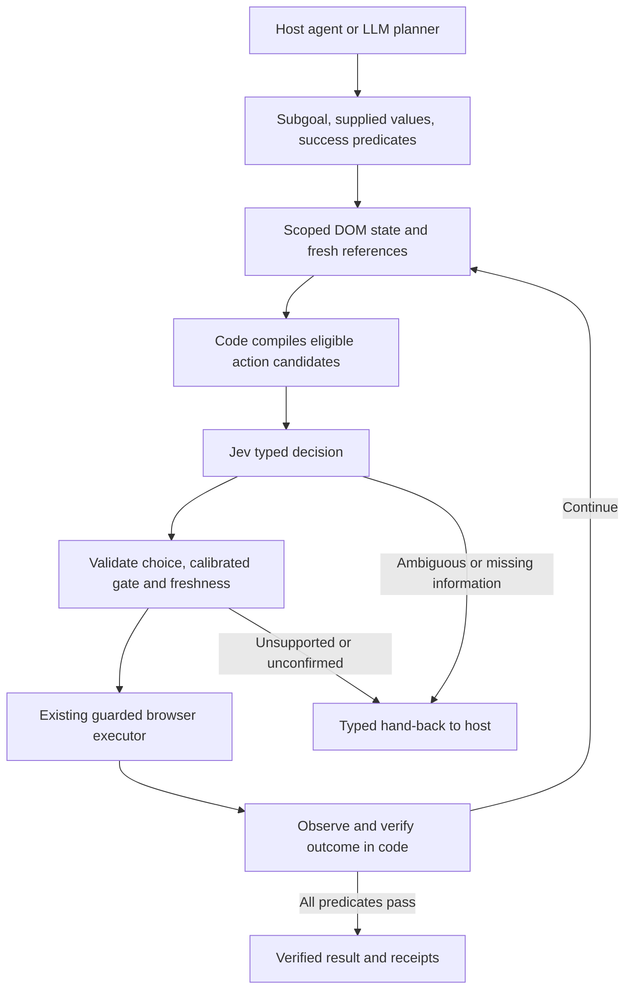

# Jev browsing: architecture research and next experiments

Reviewed 6 October 2026 (Asia/Kolkata) against JEV Browser 0.3.0. This is a research proposal, not an implemented Jev executor or a live API benchmark. Research included TypeSafe's API, model limits, failure notes, SDK source and cookbooks; browser-agent implementations and their reported measurements; two independent evaluation papers; WebMCP; and this repository's actual decision loop. No paid API requests, personal-site actions or runtime changes were made.

**Follow-up:** the recommended bounded engine is now implemented and live-tested in 0.4.0. This document preserves the pre-implementation research; see [the live report](JEV-LIVE-REPORT-2026-10-06.md) for current behavior and failed experiments.

## Recommendation

Keep the existing Chrome extension and MCP. Add a separate, well-scoped **Jev execution engine inside the local bridge**, sharing the existing browser executor, controller ownership, task ledger and memory. Preserve direct MCP control and the LLM runner as fallbacks.

The largest useful next improvement is replacing repeated LLM action-selection turns with bounded Jev decisions. Our current integration usually adds a Jev decision before an LLM decision; it does not yet provide that replacement. More browser micro-optimizations will not address this gap.

A second extension would duplicate pairing, tabs, input, frames, policy, memory and UI. The research found no API requirement that forces this duplication. A separate engine/package or development build can isolate experiments without splitting the installed browser controller. Reconsider a separate product only for a distinct deployment, such as an independently installed desktop/native host or a standalone Jev-only appliance.

## What the current Jev API actually provides

The HTTP contract is `POST https://api.typesafe.ai/v1/systemone`, with a model, a state and named questions. Choice selects from supplied options; Score evaluates ordered rubric levels; Noul returns a yes-probability. Choice supports at most 255 options; Score accepts up to 10 levels. Question identifiers are response correlation keys and are not themselves inference instructions. Put meaning in the question and criteria. [API reference](https://docs.typesafe.ai/api)

On the review date, the documented stable model and `jev-latest` alias resolve to `jev-1.13.0`. Input is text/structured JSON, with no image/audio/video input. Published limits are 64k tokens for the complete request and 32k for state plus its longest question. The price is $0.042 per million input tokens, with free output tokens. Published rate limits are dynamic, so use account-specific limits and record actual failures. Pin the model during comparison runs. The docs describe customization through state/instructions/criteria, rather than customer fine-tuning or LoRA. [Models](https://docs.typesafe.ai/models)

TypeSafe describes a different decision-model architecture, parallel sampling and RLCD training. Those are vendor descriptions, not a publicly reproducible implementation of its internal weights/training. Its launch speed comparisons concern shaped decision workloads and vendor-side conditions; they are not measurements of our Chrome tasks. [Launch and methodological caveats](https://typesafe.ai/blog/introducing-system-one-models-and-jev)

Consequently, Jev can choose an observed button or supplied field value, classify a page state, rank records, or assess evidence. A generative model, host agent or explicit caller input must supply new prose, missing free-form values and complex plans. A vision/OCR component must interpret screenshots before Jev can use their contents. [State formats](https://docs.typesafe.ai/concepts/state)

## Confidence is not a task-success percentage

For a Choice with `n` options, TypeSafe documents:

```text
confidence = (p_max - 1/n) / (1 - 1/n)
```

It is a summary of the option distribution. Noul supplies its probability without a separate confidence field. For example, a two-option Choice with top probability 0.8 has confidence 0.6. A global threshold therefore does not mean the same thing as a fixed probability or an independently measured browser success rate. [Confidence definition](https://docs.typesafe.ai/confidence)

Our proposed gate should record confidence, top probability, runner-up margin, candidate count and actual observed correctness. Tune thresholds on a calibration split by decision family; freeze them before testing unseen cases. Joint operation/target decisions need both checks, but multiplying their probabilities would assume independence we have not established. Treat their weakest accepted component as a conservative operational gate, not a calculated joint-success probability.

Different consequences can justify different decision policies. This should reuse the user's existing task authorization and browser grants; a model's certainty neither grants access nor proves an action is appropriate. [Routing pattern](https://docs.typesafe.ai/patterns/confidence-routing)

## Known weaknesses and how the harness should compensate

TypeSafe's Jev 1.13 failure notes, reviewed by the vendor on 2 October, identify literal interpretations, arithmetic/counting, date comparisons, indirection, irrelevant state, adversarial content, contradictory rubrics, option-order sensitivity and generation. These limitations are useful engineering constraints. [Vendor failure notes](https://docs.typesafe.ai/model-jaggedness/jev-1.13)

| Weakness                             | Browser design response                                                                                                   |
| ------------------------------------ | ------------------------------------------------------------------------------------------------------------------------- |
| Long or indirect goals               | Give the executor a specific active subgoal and observable completion conditions                                          |
| Irrelevant page/history content      | Include local row/section context, recent meaningful actions and relevant facts; omit unrelated navigation/history        |
| Duplicate labels and option order    | Include heading, form/row identity and control state; test reordered candidates and provide an explicit abstention option |
| Arithmetic, dates and amounts        | Parse, normalize, compare and count in code                                                                               |
| Novel text and visual interpretation | Return a typed hand-back to the host/planner/vision component                                                             |
| Adversarial or misleading page text  | Keep capability and execution checks in code; evaluate hostile labels/documents alongside benign lookalikes               |

These are proposed compensations, not evidence that the model's failure modes are eliminated.

## What the code audit found in our implementation

| Finding in 0.3.0                                                                                              | Evidence                                                                       | Proposed change                                                                                       |
| ------------------------------------------------------------------------------------------------------------- | ------------------------------------------------------------------------------ | ----------------------------------------------------------------------------------------------------- |
| The LLM chooses a tool on every ordinary runner iteration; Jev is an observation/locator helper               | `TaskRunner.#run`, [agent.mjs](../server/agent.mjs)                            | Add a bounded subtask executor that can complete several actions without another planner turn         |
| The client implements only one Choice question per request                                                    | `JevClient.choose`, [jev.mjs](../server/jev.mjs)                               | Add a general typed evaluation adapter for mixed Choice/Noul/Score questions                          |
| Distribution checks cover allowed IDs and sums, but not selected-choice argmax                                | `choose`; synthetic audit below                                                | Reject inconsistent answers before they can influence action selection                                |
| One confidence threshold covers both observation routing and locating                                         | [config.mjs](../server/config.mjs), `choose`                                   | Separate policies and calibration by decision kind                                                    |
| Locator criteria include disabled controls, but the state omits surrounding page text                         | `locate`; synthetic audit below                                                | Filter by operation eligibility and attach bounded local context; keep executor rechecks              |
| Candidate selection is positional (`slice`) and not reported as a shortlist with coverage                     | `locate` and `observation`                                                     | Report omitted counts and retrieve/expand by region; distinguish no visible match from proven absence |
| Jev observation routing sees the initial task goal; later user corrections are supplied to the LLM separately | `#run` passes `task.goal`                                                      | Supply the active subgoal and latest corrections to every decision state                              |
| Jev latency/usage are not accumulated in the task's model/tool totals                                         | `#run`; `choose` returns usage but observation events retain only the decision | Add separate request, retry, usage, timing and fallback counters                                      |
| Direct `/locate` does not propagate MCP cancellation into the Jev call                                        | [bridge.mjs](../server/bridge.mjs), [mcp.mjs](../server/mcp.mjs)               | Carry cancellation/deadlines through the bridge and decision client                                   |
| HTTP timeout is per attempt, not a total decision budget                                                      | [http-client.mjs](../server/http-client.mjs)                                   | Budget retries/backoff against the remaining task deadline                                            |
| Final success checks an exact visible excerpt, rather than every requested outcome                            | `finish_task` handling in `#run`                                               | Add task-specific structured verification and coverage checks                                         |

The [offline contract audit](report-assets/jev-local-contract-audit-2026-10-06.json) imported the actual client with a synthetic request callback. It confirmed that a selected option with probability 0.05 was accepted despite another option having 0.95, and that a disabled candidate could be offered and returned. **No browser action occurred.** Existing browser-side disabled/visibility/occlusion/access guards still apply, so this does not demonstrate disabled-control execution. The returned match also carried no surrounding page text in its inference state.

The existing extension is a valuable foundation: actual DOM references, scoped observations, native input, frame translation, shadow roots, groups, multi-tab batches, verified form filling, uncertain-write handling and durable conversations are already implemented. Prior fixture passes establish these mechanics; they do not establish live Jev browsing accuracy. See [validation](VALIDATION.md) and the [0.3 optimization report](OPTIMIZATION-REPORT-2026-10-05.md).

## What other implementations establish

| Primary source                                                                                             | Useful pattern / reported result                                                                                    | Evidence limit                                                                                                                                                     |
| ---------------------------------------------------------------------------------------------------------- | ------------------------------------------------------------------------------------------------------------------- | ------------------------------------------------------------------------------------------------------------------------------------------------------------------ |
| [Browser Use Jev Ultrafast](https://github.com/browser-use/jev-ultrafast)                                  | Dynamic operation/target choices; small text helper when text is needed                                             | Its documented MVP excludes frames, shadow roots, canvas, uploads and popup tabs                                                                                   |
| [Ultrafast decision source](https://github.com/browser-use/jev-ultrafast/blob/main/jev_ultrafast/model.py) | Speculative per-operation target questions in one request; consume only the chosen branch; validate argmax          | A valid chosen target still may be semantically wrong                                                                                                              |
| [Ultrafast measurements](https://github.com/browser-use/jev-ultrafast/blob/main/docs/performance.md)       | Three matched pairs passed; reported median 9.450 → 7.092 seconds, with protocol calls 1,092 → 101                  | One flight-search task; initial setup/navigation and independent post-check outside timing; not a broad reliability study                                          |
| [danielnc/jev-browse benchmark](https://github.com/danielnc/jev-browse/blob/main/docs/benchmark.md)        | Delegate a bounded subtask and hand back missing values/unsupported surfaces; reported agent-level speedup 1.6–3.0× | Three repeats per arm/task; standalone scripts fail or hand back on several cases that the parent agent later completes                                            |
| [Jevry](https://github.com/michaelswissa/jevry)                                                            | Complete action-pair choices where possible; explicit completion evidence and coverage                              | Its repeatedly used WebArena development slice improved 7/12 → 10/12 while median task time increased 23.367 → 44.169 seconds; not a full-suite or held-out result |

Our inference: adopt bounded delegation and structured candidates, while retaining our broader executor. The evidence does not justify promising another project's demo speed or copying its success rate.

The independent [37-dataset evaluation](https://arxiv.org/abs/2609.37647) reports 346,009 requests with varied accuracy/calibration across tasks. It is not a browser benchmark. On its prompt-injection set, a fixed threshold had high precision but only 50% recall, illustrating why a semantic detector cannot replace executor boundaries. The paper discusses public-data contamination and other limits.

A second [paired, self-audited harness study](https://arxiv.org/abs/2610.02267) emphasizes held-out thresholds and full cost accounting. An originally reported 23.9% pre-screen saving became 4.3% once the screen's own costs were counted; another threshold cost more than the baseline. These are that study's workloads, but the lesson applies to our experiment: count all decision, fallback, verification and recovery work.

## Proposed engine inside the current bridge

The following diagram describes a proposed path, not current implementation:



1. **Compile complete candidates first.** For a bounded action space, offer complete tuples such as click this observed ref, select this native option, or fill this field with this caller-supplied value binding. Code owns URLs, refs, arguments and commands; Jev returns an opaque candidate ID. Include `none`, observe/wait and hand-back outcomes. Respect the 255-option limit and report omitted candidates rather than silently implying full coverage.
2. **Use multiple questions only when useful.** If complete tuples are too numerous, ask operation plus operation-specific target questions together. Each target question states its own assumed operation; it cannot read the operation answer from the same request. Consume only the selected branch. Never batch later-page decisions as though they had already observed future state.
3. **Execute through the shared controller.** Reuse per-tab serialization, browser grants, cancellation, ledger dispatch markers and guarded native input. Discard stale pre-action choices and observe again. Once input may have started, retain the current no-replay rule.
4. **Verify explicit requirements.** A Jev completion decision is a proposal. Check route, field values, filters and result identity independently when possible. Pagination/all-record requests require completeness evidence, not one matching row. Unknown outcome and semantic evidence remain distinct from verified success.

Independent questions against one shared state are a documented API pattern. They are not sequential reasoning steps and do not exchange answers. Additional questions also add tokens, so batch only useful judgments. [Speculative fan-out](https://docs.typesafe.ai/patterns/fan-out)

TypeSafe's function-calling cookbook demonstrates choosing known functions and closed-set arguments, with code assembling the call. We can apply that principle to browser commands rather than ask Jev to generate a tool payload. [Typed function mapping](https://docs.typesafe.ai/cookbooks/function_calling)

### MCP shape and modes

Add a proposed `browser_fast_run` alongside the existing tools. It should accept a tab/subgoal, exact value bindings, bounded step/request/deadline limits, and supported success predicates. It should reuse the asynchronous task/status/cancel lifecycle when work can exceed the MCP request deadline.

Its typed outcomes should distinguish `verified`, `needs_text`, `needs_plan`, `needs_vision`, `no_candidate`, `low_confidence`, `blocked`, `budget_exhausted` and `unconfirmed`. Include final observation, candidate/decision receipts and timings so the host can resume deliberately.

| Mode                     | Model use                                                             | Best initial fit                                                            |
| ------------------------ | --------------------------------------------------------------------- | --------------------------------------------------------------------------- |
| Direct MCP               | Host agent chooses existing browser tools                             | Existing workflows and unsupported fast-path cases                          |
| Jev-only bounded subtask | Jev chooses; code/caller supplies all text                            | Navigation, supplied-value forms, native filters and known record selection |
| Hybrid                   | Host/planner supplies subgoals or text; Jev handles supported actions | Longer workflows with occasional missing values or planning                 |
| Visual fallback          | Vision model interprets pixels; existing input executes               | Canvas, icon-only/visual layouts and supported screenshot-driven tasks      |

A caller using this chat as the planner can supply text itself; no additional LLM-provider API key is required for that delegation path. A standalone side-panel agent still needs an appropriate generative component for tasks requiring new text or open-ended planning.

## Useful specialization beyond clicking

- **Form-field/value matching:** offer exact values supplied by the caller and bind them to observed fields. Prefer deterministic mappings when obvious. For values found in documents, collect spans first and let Jev choose among them; retain the source span. [Pre-parsed extraction](https://docs.typesafe.ai/cookbooks/pre_parsed_value_extraction_cookbook)
- **Result/table triage across tabs:** classify relevance per record, then sort/count/filter in code. This is likely useful for research or admin tables, but preserve original evidence and table/pagination coverage.
- **Semantic verification:** use Noul to flag unsupported extraction or missing evidence, alongside exact checks. Do not use the same model's self-assessment as the only task grader. The vendor's extraction cascade combines cheaper generation, per-field verification and escalation. [Cascade cookbook](https://docs.typesafe.ai/cookbooks/sde_cascade)
- **Workflow-skill suggestion:** rank local workflow descriptions, read the short list, allow no match and let the planner decide. This is a secondary optimization; our current small skill roster may not warrant two extra calls. [Skill suggestion recipe](https://docs.typesafe.ai/cookbooks/skill_suggestion)
- **Date controls:** choose observed textual options, then validate the intended date and compare dates in code. Avoid deriving numeric dates from Score interpolation. [Date extraction recipe](https://docs.typesafe.ai/cookbooks/date_extraction_cookbook)

### Long sessions, multi-tab work and UI

Keep durable conversation memory and explicitly saved reusable facts in the existing store. For each Jev request, retrieve only relevant facts, active subgoal, latest user corrections and a bounded recent action summary. Do not send the complete conversation by default. Decisions and receipts can improve debugging; automatically converting them into trusted saved facts would violate the existing explicit-memory behavior.

Multi-tab observation concurrency, inference batching and parallel action execution are three different things. Group independent per-tab questions in a shared state only with explicit tab-scoped instructions; responses must map back to that exact tab/frame/document. Keep foreground activation and shared browser state serialized. No second engine may bypass the bridge's single-controller ownership.

A useful UI addition is an activity view showing decision mode, candidate count, selected candidate, runner-up, abstention reason, model version, timings, request counts and estimated cost. Show confidence as a decision statistic, not a percent-complete or success probability. Retain the current visible JEV Browser group, stop control and conversation continuation.

### WebMCP as a later structured-action path

WebMCP lets participating websites expose app actions directly to browser agents. This can reduce UI steps and supply meaningful action schemas. It is a page API, distinct from our external stdio MCP transport; feature support and website adoption must be checked. It does not make arbitrary sites expose tools. Page-provided tool descriptions remain untrusted. [Chrome WebMCP overview](https://developer.chrome.com/docs/ai/webmcp/) and [agent security guidance](https://developer.chrome.com/docs/agents/security)

Recommendation: retain DOM/native input for general sites and investigate an opt-in page-tool discovery adapter later. Do not expose the privileged local browser MCP wholesale to arbitrary pages. The installed WebMCP skill was consulted for the distinction and path design; this research does not implement page registrations or a proxy.

## API transport and telemetry before live tests

The official JavaScript SDK documents `@typesafe-ai/sdk` and typed question helpers. Its versioned 0.6.0 source includes cancellation, per-attempt timeouts, retry settings, model listing and response metadata. We can adopt it behind our adapter or preserve a small validated HTTP client; either approach needs an overall deadline and secret-safe logging. Installing the SDK alone does not supply the browser action compiler or quality gates. [SDK guide](https://docs.typesafe.ai/sdk/javascript), [versioned client source](https://github.com/typesafe-ai/typesafe-sdk-js/blob/v0.6.0/src/client.ts), [request options](https://docs.typesafe.ai/sdk/javascript/api/interfaces/RequestOptions)

Record resolved model, request family, candidate count, input/output usage, queue time, network/parse time, retries, acceptance/abstention, execution and independent verification. Track LLM, Jev and browser costs separately. Report estimated token-price cost separately from billed totals and note that retries can consume extra requests.

## First live evaluation campaign

Use fresh disposable profiles and controlled fixtures first. Keep the acting model away from evaluator answers and reset fixture state between runs. The API key should remain in the existing secret store/environment; raw prompts/traces can contain private data and should stay in ignored local artifacts.

| Stage                | Proposed experiment                                                                                                                           | What it answers                                                          |
| -------------------- | --------------------------------------------------------------------------------------------------------------------------------------------- | ------------------------------------------------------------------------ |
| 1. Contract          | Synthetic malformed answers, argmax mismatch, unsupported types, cancellation, rate-limit/deadline cases                                      | Does our adapter reject invalid decisions and stop predictably?          |
| 2. Live decisions    | 200 independently labeled target/state/value cases; vary duplicate labels, no-match cases, ordering, language and distracting content         | Accuracy, abstention coverage, calibration and latency from this machine |
| 3. Calibration       | Tune only on a development split; freeze prompts, shortlist rules and thresholds                                                              | Avoid tuning and reporting on the same examples                          |
| 4. End-to-end        | Three randomized/alternating repetitions of 20 held-out task templates across direct LLM, present LLM+Jev routing, and proposed fast executor | Whether Jev improves complete tasks rather than one decision             |
| 5. Broader benchmark | A predeclared WebArena-Verified subset, then a larger held-out run if the pilot succeeds                                                      | Transfer beyond our existing form fixture                                |
| 6. Personal use      | Selected authorized workflows, with private traces and known verification conditions                                                          | Actual utility in the user's profile                                     |

The 20-template suite should cover search/navigation, independent forms, dependent autocomplete, native selects, wrong prefills, duplicate table rows, pagination, delayed UI, popups, open shadow roots, nested/cross-site frames, multi-tab comparisons and visual hand-backs. Templates and repetitions are not distinct task counts. Report frame/visual fallbacks separately from ordinary DOM performance.

Independent graders should check backend fixture records or final state, require exactly one intended submission, and detect wrong-field/value writes and duplicate actions. Measure verified success, false success, wrong actions, host/LLM turns, Jev requests, fallback rate, median/p95 end-to-end time, and total estimated/billed cost. Include setup, initial navigation and final verification in the user-experience total; expose separate loop-only timing when comparing other reports.

The [WebArena-Verified project](https://github.com/ServiceNow/webarena-verified) supplies 812 tasks with deterministic evaluators. A small development subset is appropriate for iteration, but must be labeled separately from a frozen holdout or full-suite result.

At the currently published Jev input rate, 300 requests averaging 4,000 input tokens would cost approximately **$0.0504 for Jev input alone**. This is a planning estimate, not a quote or live measurement. Additional planning/text/vision calls, retries and infrastructure must be accounted for separately. The user's available key, quota, regional latency and resolved model have not been tested in this research pass.

For latency, the useful comparison is:

```text
net saved time ≈ avoided planner turns × measured planner latency
                 − added Jev inference, observation, recovery and verification time
```

Do not keep a routing classifier on every step unless the measured downstream work it saves is greater than its cost. Never decide release readiness from mean Jev latency alone.

## Implementation order after this research

1. Harden the typed adapter and add independent Jev telemetry, cancellation and overall request budgets.
2. Build a scoped candidate compiler and shared decision-state contract, then run live target/state calibration.
3. Add the asynchronous bounded MCP subtask engine using existing ownership/ledger/executor modules.
4. Run the matched three-arm task evaluation; retain useful paths and remove extra classifier calls that do not help.
5. Add planner/text/vision hand-backs, targeted memory retrieval and the decision activity UI.
6. Evaluate table triage, skill suggestion and participating-site WebMCP paths independently before expanding scope.

Acceptance should require independently verified task quality and improved end-to-end utility together. A faster model call that creates more wrong actions, retries or host recovery is not an improvement.

Research artifacts: [offline audit](report-assets/jev-local-contract-audit-2026-10-06.json) and [source retrieval provenance](report-assets/jev-research-provenance-2026-10-06.json). Third-party source/document downloads remain in ignored `artifacts/research-2026-10-06`, outside public source packaging.
